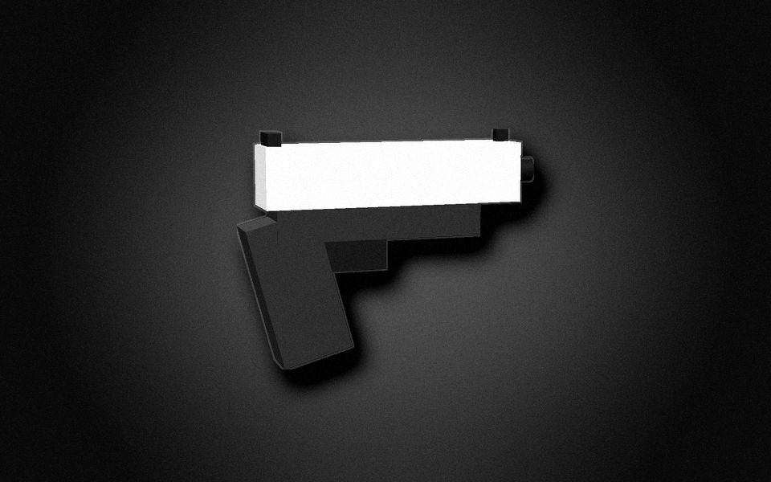
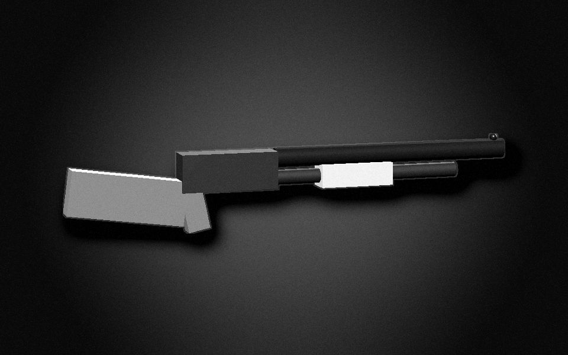
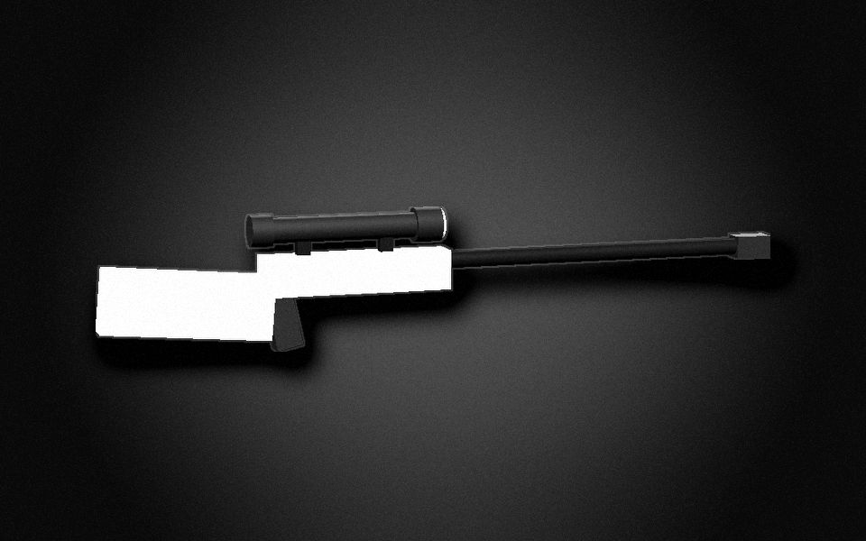
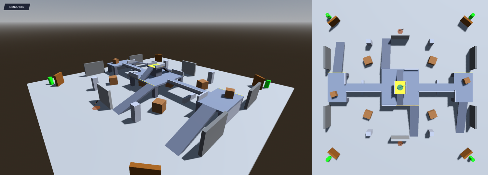
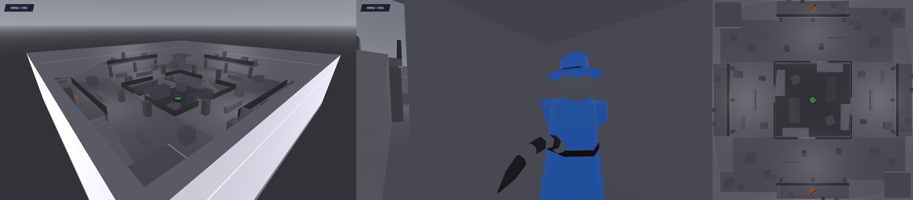
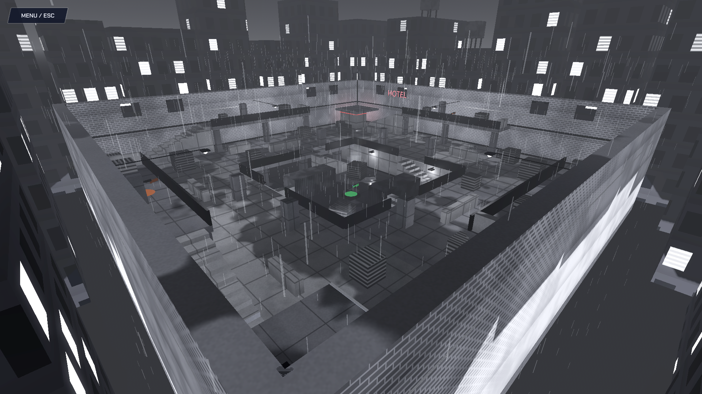
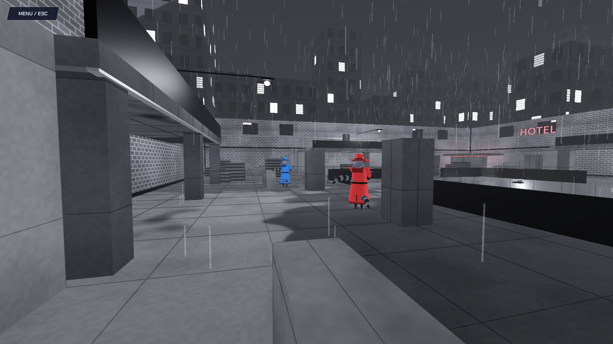
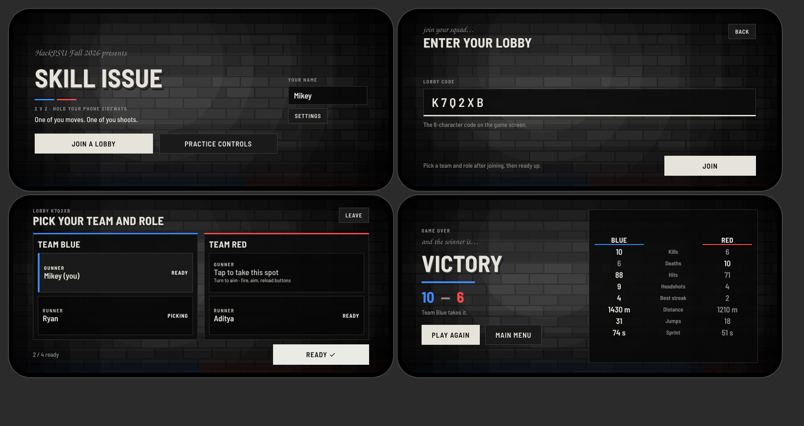

# My contributions: Michael Shepherd

<p align="center">
  
</p>

Skill Issue was a five-person team project at **HackPSU Fall 2026** (Oct 24–25). This page covers **only the parts I built**. Every item is backed by a commit or pull request in the [team repository](https://github.com/Ryan-M-Smith/SkillIssue). Networking, the relay, the control plane, the Gemini MVP, motion sensing, the gameplay HUD and medkits were my teammates' work; see the [team table](README.md#team).

**In one line:** I built the shared player character, the combat systems, the main map and the noir art direction, for the game and for the phone app.

| | |
| --- | --- |
| **Role** | Gameplay programmer, 3D modeling, level design, art direction |
| **Tools** | Godot 4.7 (GDScript, scenes, shaders), Expo / React Native (TypeScript), Next.js |
| **Pull requests** | 7 merged (#1, #6–#11), plus 2 direct commits |
| **Files I created** | 46 in `apps/game` (not counting Godot's `.uid` files), the homepage file `apps/landing/public/home-preview.html`, and the script font added to `apps/companion` |

---

## 1. The Duo: one body, two players

The core of the game is one character driven by two people. I designed it as **components plus swappable controllers**, so two phones, a keyboard or a test bot can drive the same body without the body knowing which.

```
Duo (CharacterBody3D)
├── Legs     ← the Runner: walking, sprint, jump, crouch (squashes the legs hitbox)
├── Torso    ← the Gunner: turns to aim
│   └── Head ← the Gunner: looks up and down; the camera follows it
├── Components   Movement · Aim · Weapons · Health · Team · Hitboxes
└── Controllers  phone / keyboard, added at runtime
```

- **Components** (`apps/game/components/`): movement, aim, weapon, health, team, hitbox and hurtbox. Each does one job and is wired together in `entities/duo/duo.gd`.
- **Controllers** (`apps/game/controllers/`): `phone_duo_controller.gd` and `keyboard_duo_controller.gd` both produce the same `DuoInput`, so the body doesn't care where its input came from.
- **Data-driven tuning** (`apps/game/data/`): movement, aim, weapons, teams and hitboxes are `.tres` resources, editable in the Inspector without touching code.
- **Split-screen test scene**, now `apps/game/modes/match.tscn`: became the real match mode the whole game runs on.

PR #1 added 46 new files and edited none of my teammates' files, so it merged with zero conflicts while four other commits landed.

### The model, version by version

| v0: readable boxes | Concept | v2: low-poly | v3: polish pass |
| --- | --- | --- | --- |
|  |  |  |  |
| Legs and top face separately, so you can *see* the Runner walk one way while the Gunner aims another | Two raccoons in one trench coat. The top one has the gun; the bottom one walks | 6-sided coat cones, faceted spheres, tapered sleeves and tails | Bandit mask, fedora, lapels, buttons. Trim in a darker team color so it reads at a distance |

Everything is built from Godot primitives inside `entities/duo/duo.tscn`, with team colors applied by `TeamComponent`. Legs animate in code: they swing when walking, tuck in the air and squash on crouch.

**Moments that sell the joke** (`entities/duo/duo_fx.gd`):

| Hat pop | Death split |
| --- | --- |
|  |  |
| A headshot knocks the fedora off as a physics object, even on a killing shot | On death the coat empties and both raccoons tumble out, visible on both screens |

## 2. Combat systems

| Hitboxes and spread (F3 debug view) | Sniper scope |
| --- | --- |
|  |  |

- **Zone hitboxes:** head, body and legs, sized from one data file. Head damage uses each gun's headshot multiplier; legs take ×0.75.
- **Spread:** base, plus bloom, plus a moving add scaled by speed, plus an airborne add, times a crouch multiplier. A scoped sniper is only perfect when the Runner stands still, so **the Gunner has to tell the Runner to stop**. The balance number turns into teamwork.
- **Tracers and impacts** for every shot, with color, width and lifetime set per gun. The sniper's long, thick line gives away its position.
- **Three guns** (`entities/weapons/`): gun models used in first person, on the enemy-visible body and on floating pickups. Pickups respawn, and empty pickup guns vanish so you go back for more.
- **Sniper scope:** an overlay on that team's half only, plus a glint the enemy can see.
- **Spawn protection:** 2 seconds, bullets only, ends early if you fire, and the coat shimmers while it's on.

<p align="center">
  
  
  
</p>

## 3. Maps: from Brian's arena to The Pit

| Arena v2 | The Pit (gray) | The Pit (noir) |
| --- | --- | --- |
|  |  |  |

- **Arena v2** (`maps/arena_v2.tscn`): instances Brian's original arena unchanged (now `maps/arena_base.tscn`) and adds three levels on top, so his edits kept flowing in.
- **The Pit** (`maps/the_pit.tscn`): a three-level city block in the Quake / Unreal Tournament style. The sniper sits exposed in the pit, a shotgun waits on each team's porch, and each team has a roofed corner spawn room. I tested the sightlines so no spawn point can be seen from any camping spot.
- **Playtest fixes:** spawns face their doorway, a 1 m grid shader with darker walls for orientation, and solid staircases. The [Maps note](docs/hackathon-journal/notes/10-maps.md) has the before and after photos.

## 4. Noir theme: game and phone app

<table>
  <tr>
    <td width="50%"></td>
    <td width="50%"></td>
  </tr>
  <tr>
    <td><sub>Wet asphalt, rain and neon: <code>maps/noir_surface.gdshader</code></sub></td>
    <td><sub>The Tab scoreboard as a "case file"</sub></td>
  </tr>
  <tr>
    <td></td>
    <td></td>
  </tr>
  <tr>
    <td><sub>Results screen</sub></td>
    <td><sub>The phone app in the same style (PR #9)</sub></td>
  </tr>
</table>

- **The game (PR #8):** black, white and gray everywhere, with **red and blue as the only saturated colors**, so the teams stand out. One UI kit (`ui/ui_kit.gd`) restyles every screen: the brick-wall background shader with spotlight, smoke, grain and flicker; extruded film-title lettering; and a script font.
- **The phone app (PR #9):** the same palette, extruded titles and brick-wall background, ported to React Native (`apps/companion/src/screens/phone/`). It respects the phone's reduce-motion setting.

## 5. Website homepage

<p align="center">
  
</p>

- **PR #10:** made the homepage serve the approved poster-style design (`apps/landing/public/home-preview.html`) through a one-line, reversible Next.js rewrite. The API routes the game depends on were left untouched.
- **PR #11:** removed the standings section: painted the nav item out of the hero image and removed its hotspots, links and section.
- A full snapshot of the site is kept in [docs/website](docs/website/README.md).

## Pull requests

| PR | What | Merged (Oct 2026) |
| --- | --- | --- |
| [#1](https://github.com/Ryan-M-Smith/SkillIssue/pull/1) | Duo player: components, controllers, crude model, split-screen test scene | Sat 24, 19:01 |
| [#6](https://github.com/Ryan-M-Smith/SkillIssue/pull/6) | Tunable hitboxes, spread, gun trails, F3 debug view | Sun 25, 00:58 |
| `5541944` + [#7](https://github.com/Ryan-M-Smith/SkillIssue/pull/7) | Weapon pickups, gun models, scope; simpler keyboard controls; slim low-poly raccoon | Sun 25, 03:06 / 03:29 |
| `9fae05f` | The Pit, spawn rooms and protection, hat pop and death split, raccoon polish, Arena v2 | Sun 25, 05:05 |
| [#8](https://github.com/Ryan-M-Smith/SkillIssue/pull/8) | Noir theme: rainy city map, black-and-white menus, lobby, end screen, scoreboard | Sun 25, 09:16 |
| [#9](https://github.com/Ryan-M-Smith/SkillIssue/pull/9) | Phone app noir theme | Sun 25, 10:00 |
| [#10](https://github.com/Ryan-M-Smith/SkillIssue/pull/10) | Homepage serves the new poster design | Sun 25, 11:05 |
| [#11](https://github.com/Ryan-M-Smith/SkillIssue/pull/11) | Remove the standings section and its links | Sun 25, 11:18 |

## Files I created

Paths use this fork's current names. Some files were renamed or moved during the cleanup; see [the change notes](docs/README.md#file-names-changed-in-this-fork).

```
apps/game/
├── components/   aim, health, hitbox, hurtbox, movement, team, weapon
├── controllers/  duo_controller, duo_input, keyboard_duo_controller, phone_duo_controller
├── data/         aim/, hitboxes/, movement/, teams/, weapons/   (stats as .tres resources)
├── entities/
│   ├── duo/      duo.tscn, duo.gd, duo_fx.gd, duo_legs_animator.gd, README.md
│   ├── effects/  tracer.gd
│   └── weapons/  gun_skin.gd, scope_overlay.gd, weapon_pickup.*, models/{pistol,shotgun,sniper}.tscn
├── maps/         arena_v2.*, the_pit.tscn, grid_surface.gdshader, noir_surface.gdshader
└── modes/        match.tscn, match.gd   (originally duo_sandbox: the split-screen match mode)
```

Plus `apps/landing/public/home-preview.html` (the homepage itself), noir restyling of `apps/game/ui/` (main menu, lobby, results, UI kit) and `apps/companion/src/screens/phone/`, and the rewrite in `apps/landing/next.config.ts`.

## Want the whole story?

The [hackathon journal](docs/hackathon-journal/README.md) is the notebook I kept during the weekend, converted from Obsidian. It covers the [decision log](docs/hackathon-journal/notes/18-decision-log.md), the [hour-by-hour timeline](docs/hackathon-journal/notes/19-timeline.md), the [testing log](docs/hackathon-journal/notes/17-testing-log.md), [art direction](docs/hackathon-journal/notes/14-art-direction.md) and the [retrospective](docs/hackathon-journal/notes/21-open-items-and-retrospective.md).
