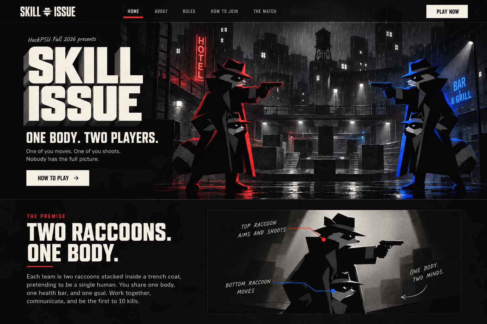
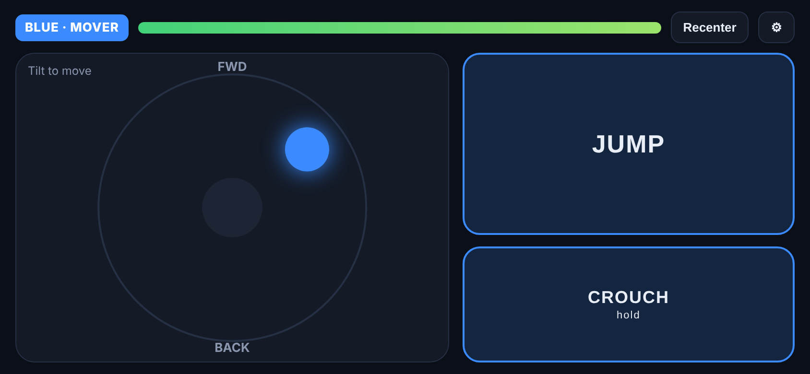
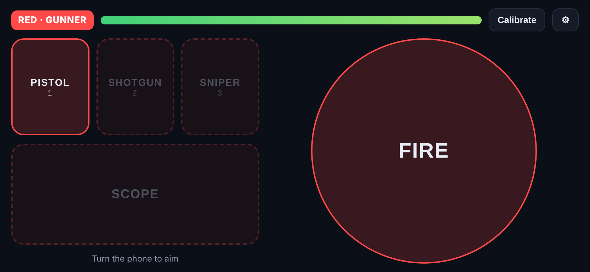
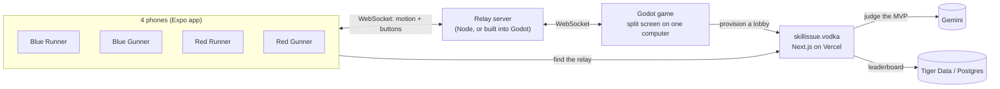

<p align="center">
  
</p>

<h1 align="center">Skill Issue</h1>

<p align="center">
  <b>One body. Two players. Zero excuses.</b><br>
  A 2v2 split-screen shooter where each team shares one character, controlled by two phones.<br>
  Built in about 20 hours by a team of five at <b>HackPSU Fall 2026</b> (Oct 24–25, Penn State University Park).
</p>

<p align="center">
  
  
  
  
  
</p>

---

## The idea

Each team is **two raccoons stacked inside one trench coat**, pretending to be a person. Two teammates control that one body from two phones:

| Role | Raccoon | Phone controls |
| --- | --- | --- |
| **Runner** | the bottom one, does the walking | tilt to move, twist to sprint, flick to jump or crouch |
| **Gunner** | the top one, in the fedora, holds the gun | turn the phone to aim; FIRE, AIM, RELOAD and SWITCH buttons |

They share one health bar and one score. Neither player can win alone. The first team to **10 kills** wins, or whoever is ahead when the clock runs out (5 minutes by default, 2 to 5 if the host changes it).

<p align="center">
  
  <br><sub>A split-screen match in <b>The Pit</b>: Blue on the left, Red on the right.</sub>
</p>

## The phones

| Runner phone | Gunner phone |
| --- | --- |
|  |  |

## How it fits together



The phones never talk to the game directly. Each phone joins a lobby by code and streams its motion through the relay. The Godot game turns that motion into movement and aim for each team's shared body. The website explains the game and also runs the small API the game and phones depend on (`/api/games`, `/api/connection`, `/api/mvp`).

## Quick start

1. Open `apps/game` in **Godot 4.7** and press **F5**. Choose **Create a Lobby**.
2. On the phones, run the companion app with Node.js 24 from the repository root:
   ```sh
   npm install
   npm run companion:lan
   ```
3. On each phone, open the app, choose **Join a Lobby**, enter the code, then pick a team and a role.

No phones? Choose **Practice / Keyboard** in the game menu.

The full guide, covering controls, deployment, graphics settings, the MVP judge and tests, is in **[docs/setup-and-development.md](docs/setup-and-development.md)**.

## Repository layout

| Folder | What's inside |
| --- | --- |
| [`apps/game`](apps/game/README.md) | Godot 4.7 game: the Duo character, weapons, maps, menus, built-in lobby server, smoke tests |
| [`apps/companion`](apps/companion/README.md) | Expo / React Native phone controller, with practice mode for both roles |
| [`apps/landing`](apps/landing/README.md) | Next.js website and control-plane API (skillissue.vodka) |
| [`apps/server`](apps/server/README.md) | Optional standalone Node WebSocket relay and its network tests |
| [`packages/protocol`](packages/protocol/README.md) | Shared message types for the game, phones and relay |
| [`docs`](docs/README.md) | Setup guide, network protocol, deployment notes, dev reports, screenshots, website snapshot, hackathon journal |
| [`archive`](archive/README.md) | Unused starter-template files, kept for history |
| [`scripts`](scripts/test-game.mjs) | `test-game.mjs`: runs the Godot import and smoke tests |

## Team

| Person | Main areas |
| --- | --- |
| [Ryan Smith](https://github.com/Ryan-M-Smith) | Repo owner and monorepo; companion app; relay and protocol; website and control plane; game flow; Gemini MVP |
| [Michael Shepherd](https://github.com/shephmic77) | Duo character, combat systems, weapons, maps (The Pit), noir theme for game and app, homepage ([details](CONTRIBUTIONS.md)) |
| [Aditya Pratap Singh](https://github.com/Aditya-Pratap-Singh-17) | Motion sensing, gameplay HUD, graphics and pause menus, smoke tests, Android sensor and gunner smoothing fixes |
| [Brian Podolskiy](https://github.com/Brian-Podolskiy) | First map and prototype player (now in [`apps/game/prototypes`](apps/game/prototypes/README.md)), health, armor and medkits |
| [Kenneth Tran](https://github.com/trnKen1) | Godot project structure, split-screen views, global events, early HUD, networking layer, audio |

Roles are taken from the commit history. See [Team & Roles](docs/hackathon-journal/notes/04-team-and-roles.md).

## About this fork

This is [Michael Shepherd](https://github.com/shephmic77)'s fork of the team repository **[Ryan-M-Smith/SkillIssue](https://github.com/Ryan-M-Smith/SkillIssue)**. The game code is the team's. This fork adds:

- **[CONTRIBUTIONS.md](CONTRIBUTIONS.md)**: what I built, with pictures and the pull requests behind it.
- **[The hackathon journal](docs/hackathon-journal/README.md)**: my notes from the weekend, covering decisions, timeline, testing, art direction and the retrospective.
- **[A website snapshot](docs/website/README.md)**, so the homepage can still be seen after the domain expires.
- A tidier layout: loose files moved into folders and given clearer names, with every reference updated and the Godot smoke tests re-run.

## License

[Apache License 2.0](LICENSE.txt). Fonts and sound effects keep their own licenses (see [`apps/game/audio/CREDITS.md`](apps/game/audio/CREDITS.md) and the license files next to each font).
