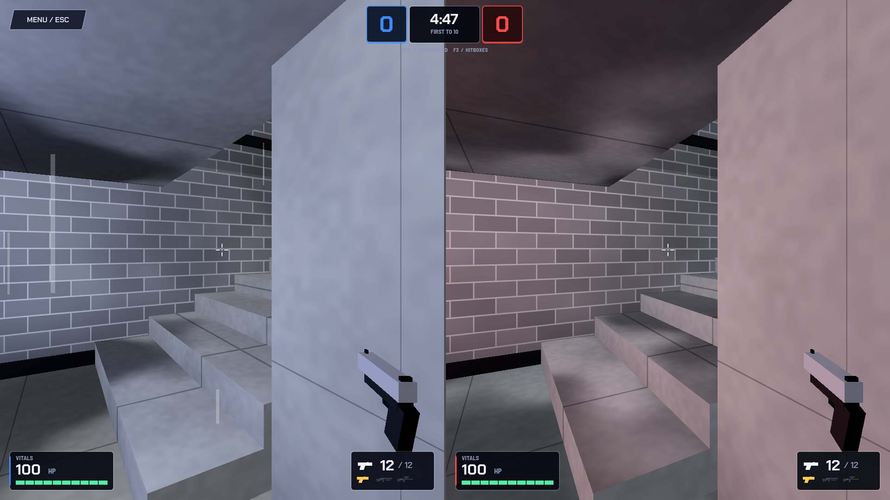

# Game (`apps/game`)

The Godot 4.7 project: the split-screen match, the shared Duo character, weapons, maps, menus and the lobby server built into the game.



## Run it

1. Open this folder in **Godot 4.7** (the GL Compatibility renderer).
2. Press **F5** for the main menu. Choose **Create a Lobby** to play with phones, or **Practice / Keyboard** to play alone.
3. To jump straight into a match, open `modes/match.tscn` and press **F6**.

Keyboard controls, the F3 hitbox view and tuning tips are in the [Duo README](entities/duo/README.md). The full guide is in [docs/setup-and-development.md](../../docs/setup-and-development.md).

## How a match is put together

```
ui/main_menu.tscn ── Create a Lobby ──▶ ui/lobby.tscn ── all 4 phones ready ──▶ modes/match.tscn ──▶ ui/results.tscn
                                                                                       │
                                     loads modes/split_screen_layout.tscn (two views + HUD)
                                     swaps in the chosen map (maps/the_pit.tscn by default)
                                     spawns one entities/duo/duo.tscn per team
```

## Folder map

| Folder | What's inside |
| --- | --- |
| `modes/` | `match.tscn` / `match.gd`: the match itself (spawning, rules, clock, score, respawns). `split_screen_layout.tscn`: the two camera views and HUD the match builds on |
| `entities/duo/` | The Duo, the shared two-player character: scene, wiring, model effects (hat pop, death split), leg animation |
| `components/` | Building blocks for the Duo: movement, aim, weapon, health, team, hitbox, hurtbox, power-ups |
| `controllers/` | Input sources that drive a Duo: phones, keyboard, and the common `DuoInput` they produce |
| `data/` | Tuning numbers as `.tres` resources: aim, hitboxes, movement, teams, weapons. Edit them in the Inspector |
| `entities/weapons/` | Gun models, floating weapon pickups, sniper scope overlay, gun skins |
| `entities/pickups/` | Health pickups, arena pickups, mystery boxes |
| `entities/effects/` | Bullet tracers and impact puffs |
| `maps/` | `the_pit.tscn` (main map), `arena_v2`, `arena_base.tscn` (Brian's original arena), surface shaders |
| `materials/` | Colors for the original arena's walls, cover, spawn pads and pickups |
| `ui/` | Main menu, lobby, results, pause and graphics menus, HUD, team HUD, crosshair, the noir UI kit, fonts |
| `scripts/` | Autoloads (game session, input router, events, music, sound effects, match stats, graphics settings), the MVP judge, and `network/` (lobby server, client, motion interpreter) |
| `audio/` | `music/`, `ui/` (menu sounds), `weapons/`. See [credits](audio/CREDITS.md) |
| `tests/` | Headless smoke tests: gameplay, lifecycle, rules |
| `prototypes/` | Brian's first player and weapon prototype, kept as history. See [its README](prototypes/README.md) |

## Autoloads

Global singletons registered in `project.godot`:

| Name | Script | Job |
| --- | --- | --- |
| `GameEvents` | `scripts/game_events.gd` | Signals shared across the game (health, kills, score) |
| `NetworkClient` | `scripts/network/network_client.gd` | Connection to the relay |
| `GameSession` | `scripts/game_session.gd` | Lobby code, players, settings for the current session |
| `InputRouter` | `scripts/input_router.gd` | Routes each phone's input to the right Duo |
| `LobbyServer` | `scripts/network/lobby_server.gd` | The WebSocket lobby server built into the game |
| `MatchStats` | `scripts/match_stats.gd` | Kills, accuracy, damage and distance for the results screen |
| `GraphicsSettings` | `scripts/graphics_settings.gd` | Resolution, render scale, window mode, V-sync |

## Tests

From the repository root, with `GODOT_BIN` pointing at a Godot 4.7 executable:

```sh
npm run test:game
```

This imports the project, then runs `tests/gameplay_smoke.gd`, `tests/lifecycle_smoke.gd` and `tests/rules_smoke.gd`.
