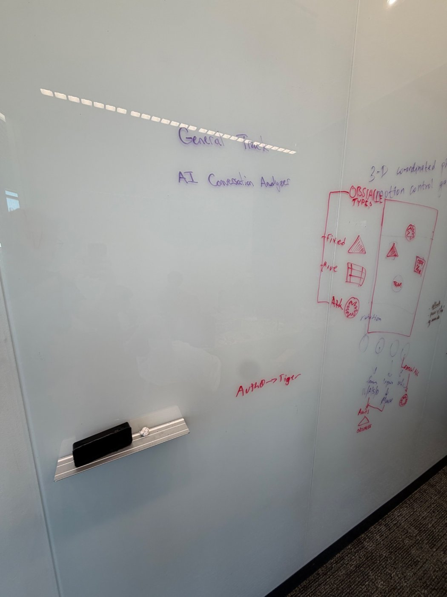
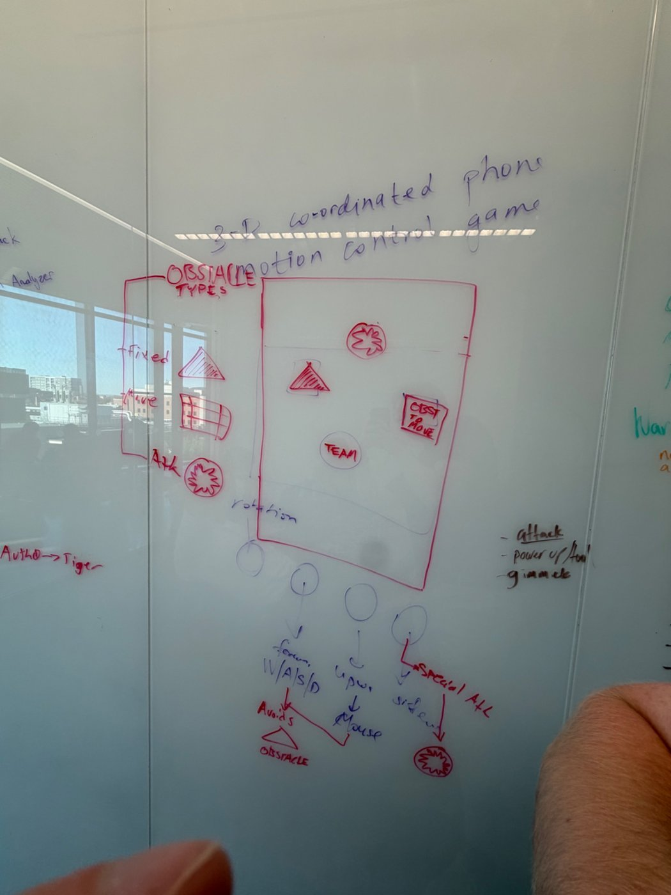
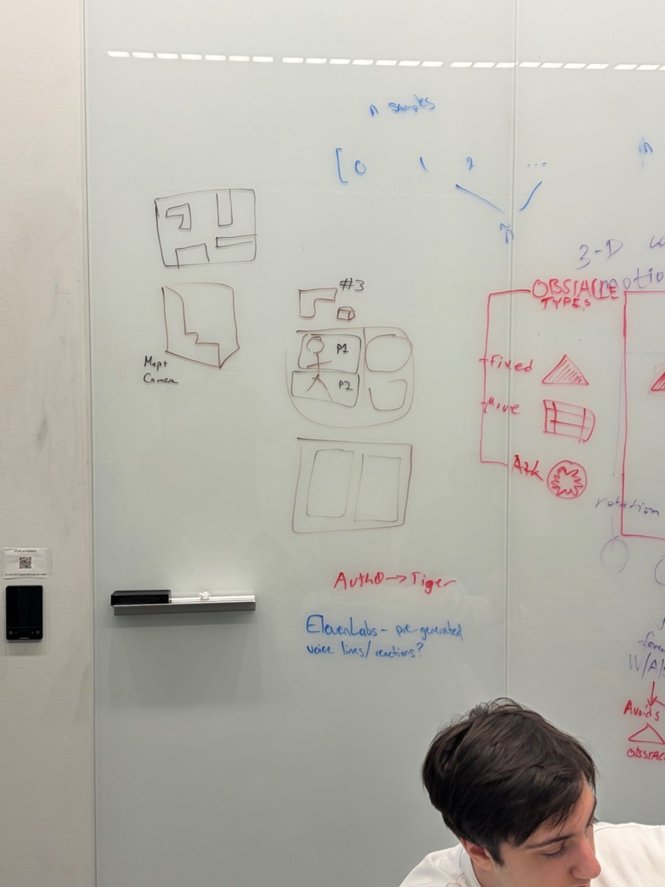
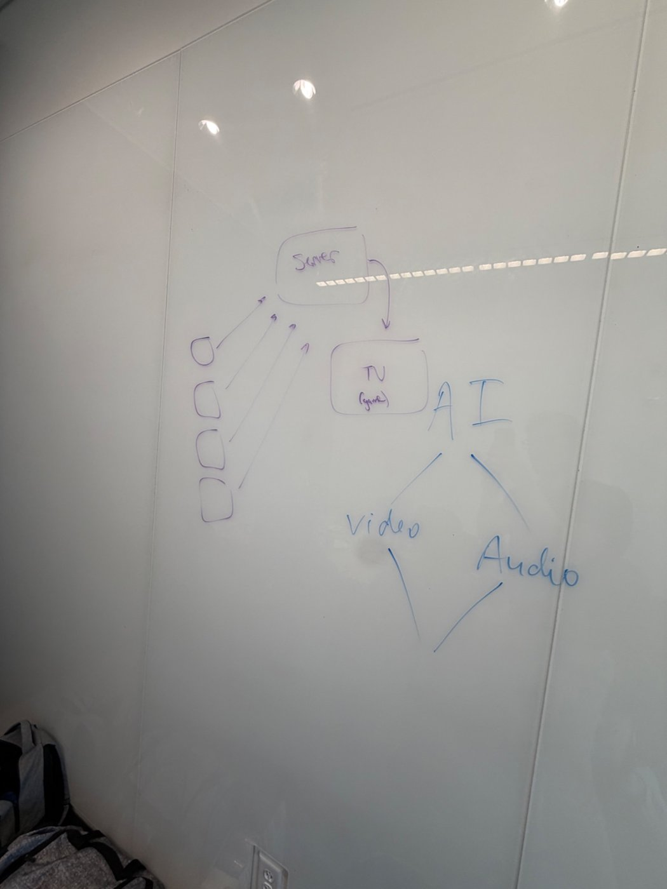
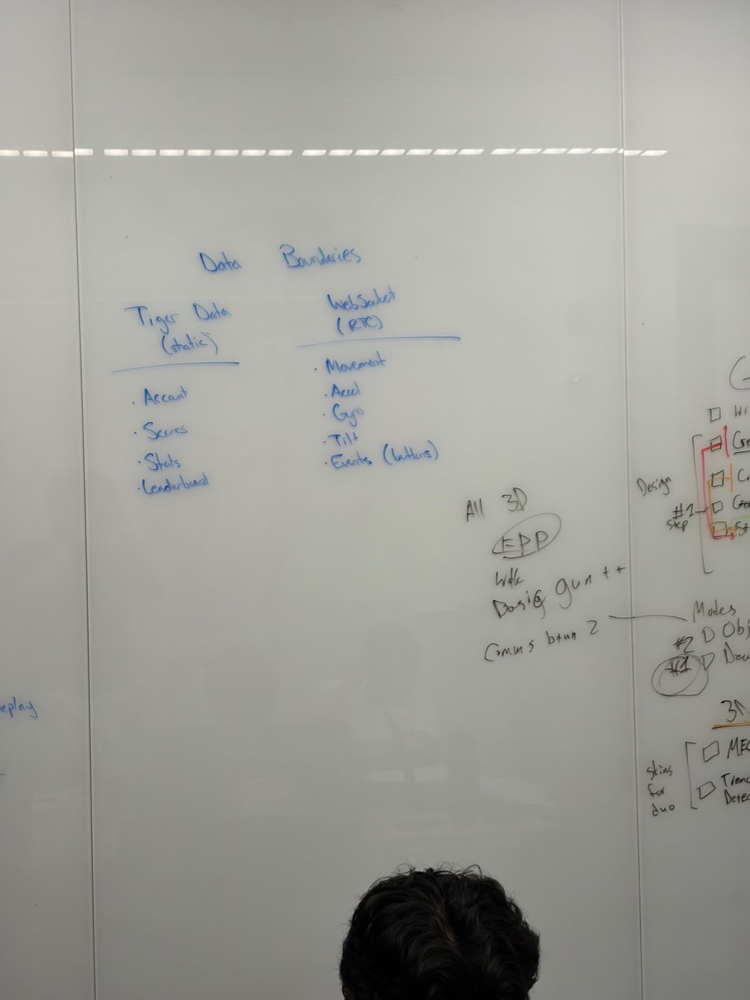
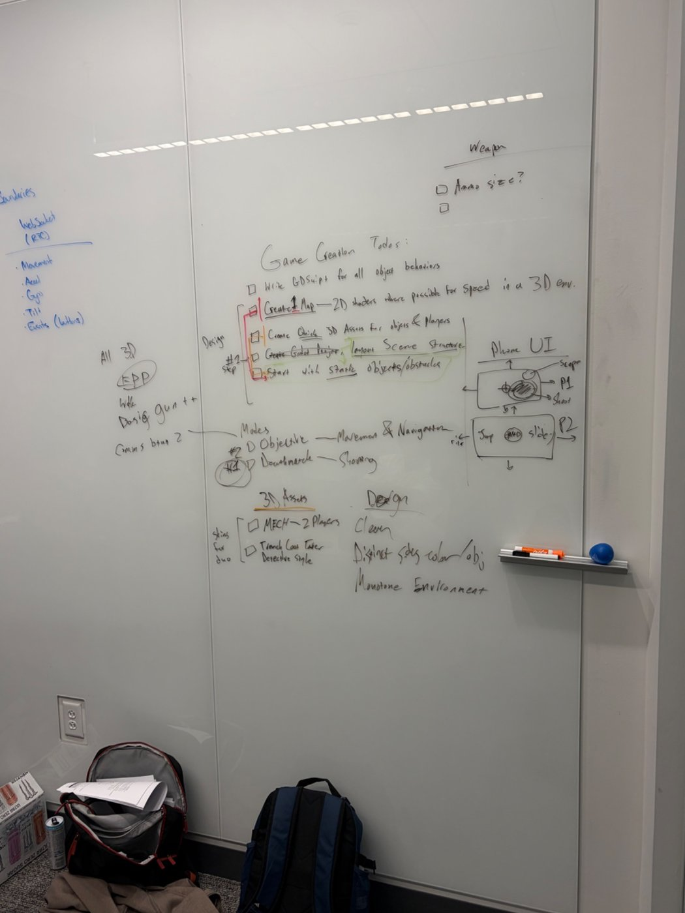
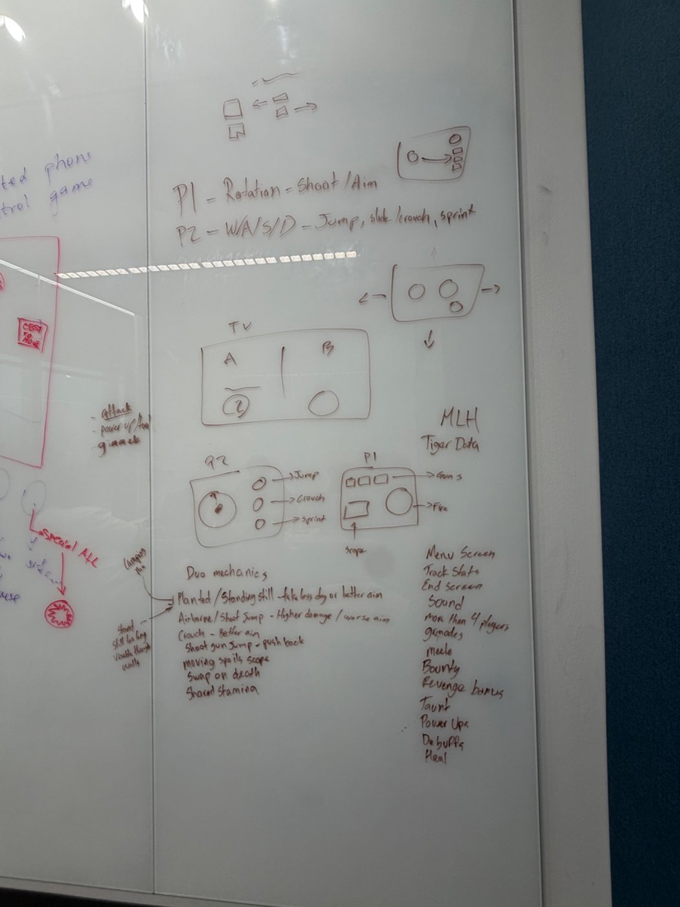

# Whiteboard Brainstorm

Photos of the team's whiteboards from the planning session at HackPSU, with a transcription of each. Handwriting is partly illegible, so anything uncertain is marked *(?)*. These are **ideas and plans**. What actually shipped is noted in the "Outcome" lines.

> [!TIP]
> **How to read this note**
> Each board is followed by a transcription and an **Outcome** line that links to where the idea ended up (built, changed, or parked).

---

## Board 1: Early direction (General Track vs. motion game)

- **"General Track: AI Conversation Analyzer"**: a non-game idea for the general track.
- **"3-D coordinated phone motion control game"**: the idea that won.
- **Obstacle types** (red box): *fixed* (triangle), *move* (bars), *attack* (spiky circle).
- **"Auth0 → Tiger"**: sponsor tech noted early (sign-in via Auth0, data in Tiger).

**Outcome:** the motion game won. The obstacle-course framing turned into an arena shooter once we drew the Rivalry and 4+ cards.

## Board 2: The motion-control game, close up

- A phone screen sketch with targets/obstacles on it (team, triangle, crate *(?)*).
- Under the phone, three inputs: **rotation** → *W/A/S/D* (move, avoids obstacles), **upward** → *mouse* (look), **sideways** → *special attack*.
- Side note: **"Attack / power-up / gimmick"**.

**Outcome:** "rotation = move, upward = look" became the **Runner tilt** and the **Gunner gyro**, but split across *two* phones instead of one ([07 Controls & Motion](07-controls-and-motion.md)).

## Board 3: Maps, motion sampling and sponsors

- **"n samples" array** `[0, 1, 2, …]`: averaging the last *n* sensor readings to smooth motion.
- **Map sketches**: a maze-like room and an L-shaped stair layout, labelled "Maps / Camera".
- **"#3"**: a camera/screen sketch with a player (M) and a second player (P2) inside.
- A TV with two halves.
- **"Auth0 → Tiger"** and **"ElevenLabs: pre-generated voice lines / reactions?"**

**Outcome:**
- Ryan built a **rolling average** (10 samples) into the companion at 17:23–17:40 on Saturday.
- The maps became Brian's **arena box** and later my **The Pit** ([10 Maps](10-maps.md)).
- **ElevenLabs was not built** (no sound in the game yet; see [21 Open Items & Retrospective](21-open-items-and-retrospective.md)).

## Board 4: System architecture

- **Four phones** → **server** → **TV (game)**.
- **AI** → **Video** / **Audio**: AI-generated media as a sponsor idea.

**Outcome:**
- The four-phones → server → game shape is exactly what shipped. The server ended up as a **WebSocket relay**, plus an embedded lobby server in Godot ([05 Architecture](05-architecture.md)).
- AI shipped as **Gemini** judging the match MVP and drawing a raccoon badge, not as video/audio.

## Board 5: Data boundaries

| **Tiger Data** (static) | **WebSocket** (RTC) |
|---|---|
| Account | Movement |
| Scores | Accel |
| Stats | Gyro |
| Leaderboard | Tilt |
| | Events (buttons) |

Also on this board: **"All 3D, FPP, walk, basic gun++, comms btwn 2"**, **Modes: #1 Deathmatch (shooting), #2 Objective (movement and navigation)**, and a **3D assets** list (see board 6).

**Outcome:** this boundary held. Tiger Data was only ever meant for durable data (accounts, scores, the leaderboard). Live input never touches the database; it goes over WebSocket. The README says the same: *"Tiger Data is used for durable data and telemetry, not live WebSocket transport."* Only **Deathmatch** was built.

## Board 6: Game creation todos, 3D assets, design and phone UI

**Game Creation Todos**
- [ ] Write GDScript for all object behaviors
- [ ] Create 1 map; use 2D shaders where possible for speed in the 3D environment
- [ ] Create quick 3D assets for objects and players
- [ ] Godot project and scene structure layout
- [ ] Start with static objects and obstacles

**3D assets (skins for the duo):** a **MECH** (2 players), or a **trench coat taker, detective style**.

**Design:** clean · distinct sides by color/object · **monotone environment**.

**Weapon:** ammo size?

**Phone UI sketch:** P1 has scope + shoot; P2 has jump + slide.

**Outcome:**
- **One map**: done, The Pit ([10 Maps](10-maps.md)).
- **"Shaders where possible for speed"**: the noir map uses one `noir_surface.gdshader` for every surface pattern (concrete, brick, metal, windows) instead of textures ([11 Game UI & Noir Theme](11-game-ui-and-noir-theme.md)).
- The **detective trench coat** skin won over the mech ([08 Duo Character](08-duo-character.md)).
- **"Monotone environment, distinct sides by color"** is exactly where the noir theme ended up: a gray city with red and blue neon.
- **Ammo**: magazines were added (pistol 12, shotgun 6, sniper 5) ([09 Weapons & Combat](09-weapons-and-combat.md)).

## Board 7: Controls, duo mechanics and the feature wishlist

**Controls**
- **P1** = rotation → shoot/aim. **P2** = W/A/S/D, jump, slide/crouch, sprint.
- **TV:** split screen, **A | B**.
- **P2 pad:** joystick + jump, crouch and sprint buttons. **P1 pad:** three gun buttons + scope + fire.

**Duo mechanics**
| Idea | Status |
|---|---|
| Planted / standing still → take less damage or better aim | **Partly built**: spread is tightest standing still; no damage reduction |
| Airborne / shoot-jump → higher damage, worse aim | **Partly built**: airborne spread penalty; no damage bonus |
| Crouch → better aim | **Built** (crouch spread multiplier) |
| Shotgun jump → pushback | Not built |
| Moving spoils the scope | **Built** (sniper +6° moving, +10° airborne) |
| Swap roles on death | Not built |
| Shared stamina | Not built |
| Anti-camping: stand still too long → visible through walls | Not built |

**Feature wishlist**
| Feature | Status |
|---|---|
| Menu screen | **Built** |
| Track stats | **Built** (kills, KDR, accuracy, damage, distance) |
| End screen | **Built** (winner reveal + Gemini MVP) |
| Sound | Not built |
| More than 4 players | Not built (Player Count 1–4 for testing) |
| Grenades, melee | Not built |
| Bounty, revenge bonus, taunt | Not built |
| Power-ups, debuffs | In progress on Kenneth's `powerups` branch (**unverified**) |
| Heal | **Built** as medkits (Brian); my regen version did not stay on `main` ([09 Weapons & Combat](09-weapons-and-combat.md)) |

**MLH: Tiger Data** is written in the corner. See [20 MLH & Partner Tech](20-mlh-and-partner-tech.md).

---
Related: [02 Pitch & Concept](02-pitch-and-concept.md) · [07 Controls & Motion](07-controls-and-motion.md) · [05 Architecture](05-architecture.md)
