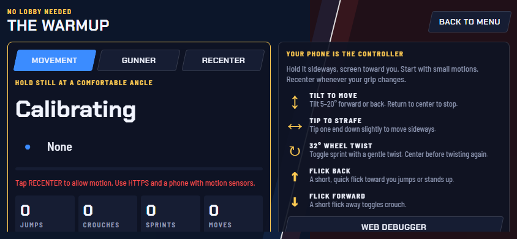

# Match Flow & Rules

## The loop (confirmed on `main`)
1. **TV:** open the game → **Create a Lobby**. The game provisions a lobby through skillissue.vodka and shows a **six-character code** (**Copy Code** copies it).
2. **Phones:** open the Skill Issue app → **Join a Lobby** → type the code.
3. Each phone picks **Blue or Red** and **Runner or Gunner**. The four slots are exclusive.
4. Tap **Ready**. When every required slot is ready, a **3-second countdown** starts.
5. **Match:** split screen, Blue left and Red right. Start with a pistol; grab the shotgun and sniper from the floating pickups; the fedora flies off on headshots; medkits heal.
6. **End:** first to **10 kills**, or the leading team at **5:00**. The host can also **End Match** from the Esc menu: the leader on kills wins, or it's a draw.
7. **Results:** "and the winner is…" → winning team (or **Nobody**), five stats per team, and the **Match MVP**.
8. **Play Again** keeps the same lobby and code; **Main Menu** closes it.

*Lobby on the TV (noir theme): the code tiles and both team panels showing open slots.*

## Rules table
| Rule | Value on `main` | Notes |
|---|---|---|
| Format | 2v2, one body per team | Runner + Gunner share one health bar |
| Win | 10 kills, or most kills at 5:00 | Draw possible when ended by host or tied at time |
| Health | 100 | Shared |
| Starting gun | Pistol, 12-round magazine, 1.25 s reload | Never runs out |
| Pickups | Shotgun (6 / 1.8 s), sniper (5 / 2.2 s) | Floating; respawn after 10 s |
| Headshots | Gun's headshot multiplier; the **hat flies off** | [09 Weapons & Combat](09-weapons-and-combat.md) |
| Healing | **Medkits** (Brian) | My regen version is not on `main` |
| Respawn | Short delay, in a roofed **spawn room** | **2 s spawn protection** (firing ends it) |
| Streaks | Kills build a streak, reset on death; best streak in results | |
| Player Count | 1–4 (default 4), in Settings | For testing with fewer phones |

> [!NOTE]
> **Values that are still "tunable, not final"**
> Respawn delay, pickup timers and spread are all in `.tres` data files. See [16 Tuning](16-tuning.md). Tie handling at 5:00 follows the README: equal kills means a draw.

## Practice modes
- **Phone:** *Practice Controls* teaches both roles without a lobby (screenshot from the repo's `docs/previews`):

- **Game:** *Practice / Keyboard* runs a local match without phones. Hold **Tab** for the scoreboard; **F3** shows hitboxes and spread.

## End screen and the Match MVP
- Five stats per team: **kills, KDR, accuracy, damage dealt, distance traveled (m)**.
- **Anyone can be MVP.** Gunners usually win it on kills, KDR or damage. Runners win it on distance, or for being so hard to hit that the enemy scored little or shot badly.
- The game posts the match to `POST /api/mvp`, where **Gemini** returns `{mvp, headline, reason}`. If that's offline or slow (over 12 s), the game picks with a local rule and labels the card "Judged offline".
- **Badge:** Gemini draws a raccoon medallion for the MVP (`/api/mvp/badge`). With no MVP, it draws a noir alley with a lurking raccoon. Judging and drawing start at the final whistle so they're ready when the results open.

*Results screen (noir): script "and the winner is…", the banner, team bars and the stat table. The MVP card was added later by Ryan's end-screen commit.*
