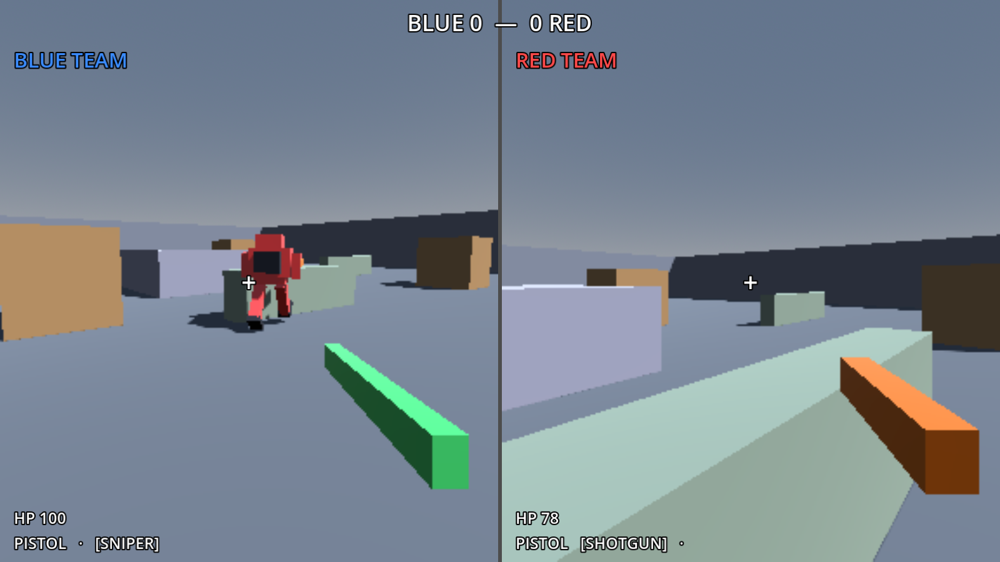
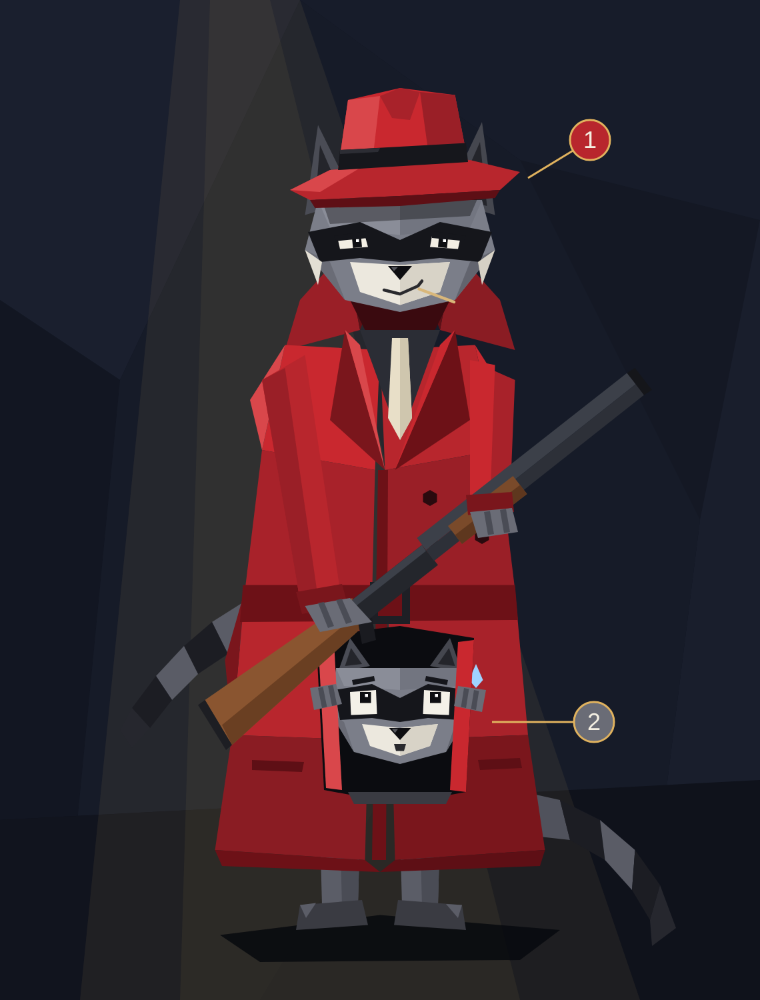
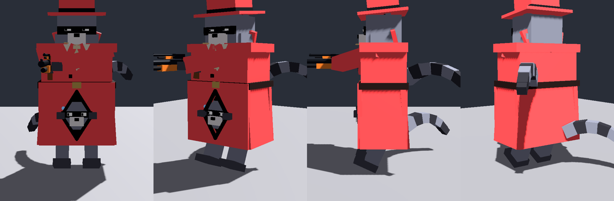
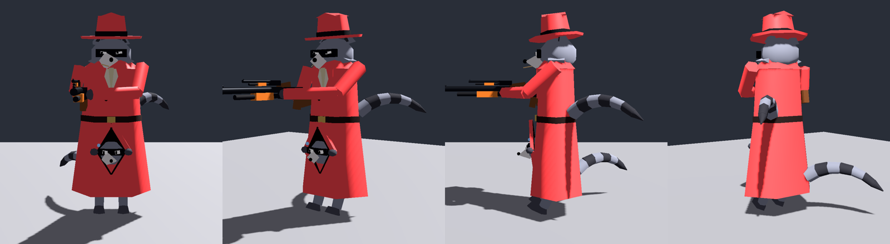
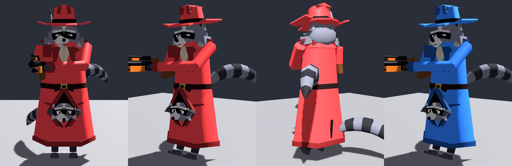
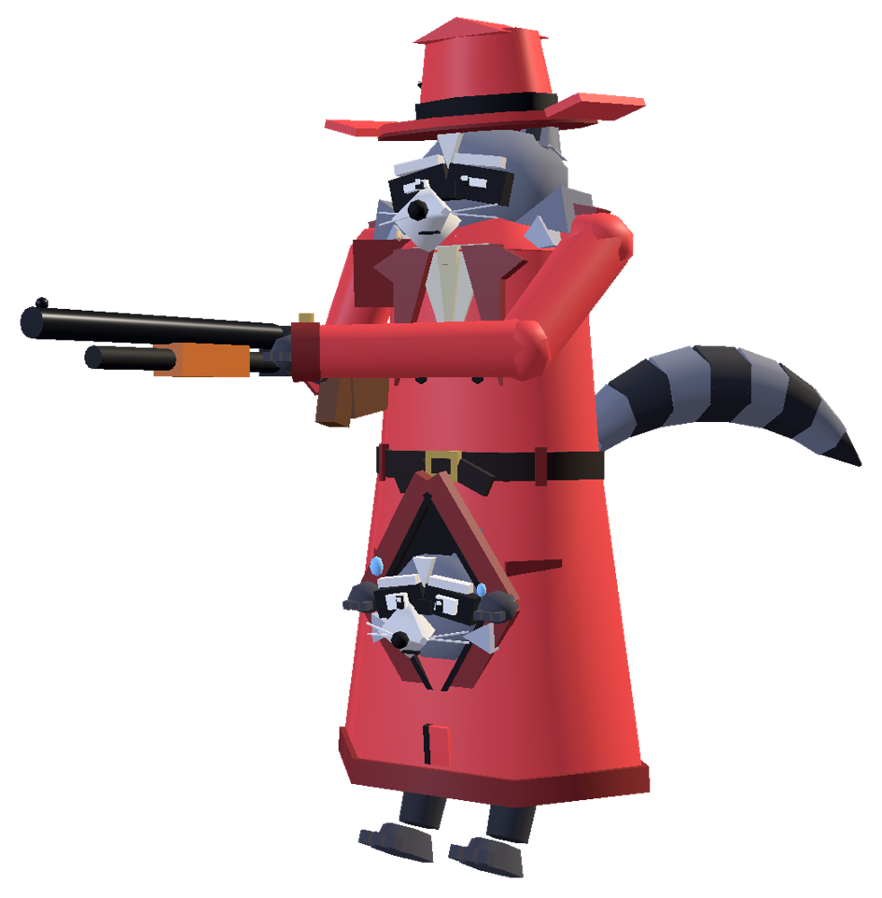
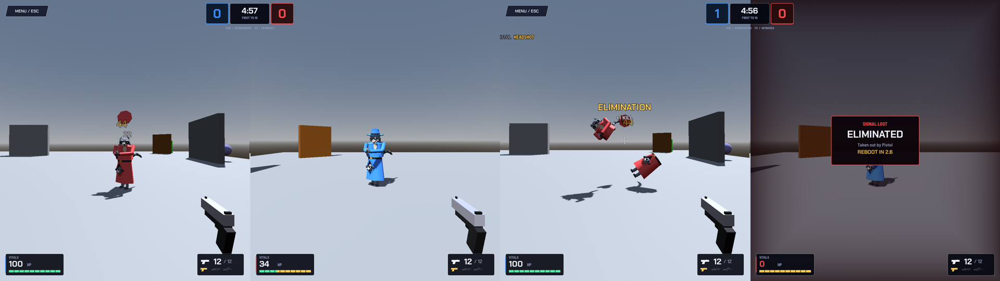
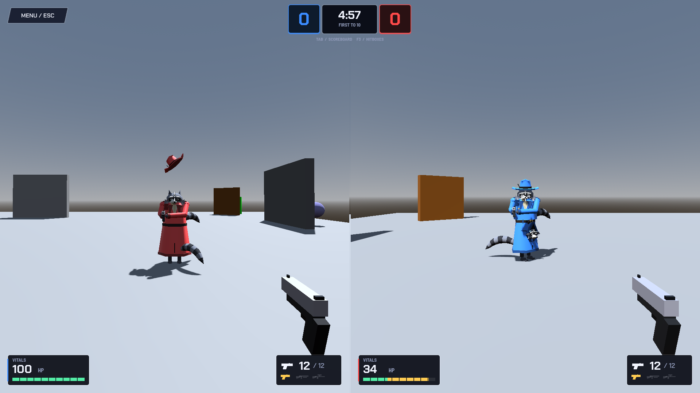

# Duo Character

The Duo is the one body each team shares. I owned it from the first commit: the scene, its components, its controllers, its hitboxes and every version of its model. The rule all the way through was **function before looks**: the model's first job is to make the game readable (who's where, which way each half faces, what they're holding, whether a shot landed).

## Evolution in pictures

### v0: Crude boxes (Sat 18:01, PR #1)

*Blue's view of Red mid-stride with its shotgun. Separate legs and top, a backpack showing which way the top faces, dark feet showing which way the legs face, and a cockpit box as the head.*

| Feature | Why it mattered |
|---|---|
| Legs and top face separately | You can **see** the Runner walking one way while the Gunner aims another, which is the two-player idea made visible |
| Leg animation in code (swing, tuck in air, squash on crouch) | Shows what the Runner is doing, with no animation files |
| Third-person gun matches your weapon and tilts with aim | Enemies can read the threat (sniper vs shotgun) |
| Hit flash (body flashes white) | Instant hit confirmation |
| Own body hidden from own camera | Clean first-person view |

### Concept: two raccoons in one trench coat (Sat 19:15)

- **Top raccoon = Gunner:** fedora, squint, holds the gun.
- **Bottom raccoon = Runner:** peeks out where the coat parts, does the walking, **no gun**.
- **Two tails** stick out so it reads as two raccoons even from behind.
- **Team color = coat + fedora.** Fur, mask and gun stay the same, which fits how `TeamComponent` tints the model.

### v1: First raccoon in Godot (Sun 02:24–02:36)

*Built from Godot primitives inside `duo.tscn`, keeping the node names the animator and hitboxes already use. The coat opening is a **diamond** (flaps parting, paws holding it open), not a square window.*

### v2: Slim low-poly (Sun 02:58–03:10, PR #7)

*The boxy version looked like a robot. v2 uses 6-sided coat cones, faceted spheres, and tapered sleeves and tails for a "poly art" look. Hitboxes were retuned to the slimmer shape.*

### v3: Polish pass (Sun 04:26–04:50, `9fae05f`)

*Bandit mask (two slanted patches + bridge), white brows, blaze and chin, fluffy cheeks, bushy striped tails, a fedora with dents + feather, notched lapels, double-breasted buttons, epaulets, storm flap, cuffs, pockets, back vent and hem. **Trim uses a darker team color** so it reads at a distance.*

*Hero render of the in-game model. Later the fedora brim was replaced with one smooth 12-sided brim, because the side plates looked like rectangles stuck to the hat.*

## Moments that sell the joke

- **Hat pop:** a headshot knocks the fedora off as a short-lived physics object (it fires *before* the damage, so a killing headshot still pops the hat). **Confirmed on `main`** (`duo_fx.gd`).
- **Death split:** on death, the coat empties and **the two raccoons tumble out** as physics copies that both screens can see. **Confirmed on `main`.**
- **Spawn shimmer:** the coat shimmers during the 2 s spawn protection.

*In-match: a headshot pops Red's hat.*

*In-match: the death split, with Blue's screen showing ELIMINATED.*

## Rig map (for anyone replacing the model)
| Concept part | Rig slot | Notes |
|---|---|---|
| Bottom raccoon (peeking head, paws), coat skirt, feet, tail | `Legs/Model` | Keep the `LeftHip` / `RightHip` pivots and the walk animation keeps working |
| Coat top, sleeves, paws, gun | `Torso/Model` | Coat is team-tinted; anything in the `no_tint` group isn't |
| Top raccoon head + fedora | `Torso/Head/Model` | Fedora at `Torso/Head/Model/Fedora` (used by the hat pop) |

## The anatomy rule (non-negotiable)
> [!IMPORTANT]
> **Top raccoon = Gunner and holds the gun. Bottom raccoon = Runner, **no gun and no gun-holding pose.****
> One continuous coat, one pair of legs, one body. The top raccoon rides on the bottom one's shoulders **inside** the coat. Earlier generated art kept arming the bottom raccoon or drawing two separate raccoons; that must not come back in new art, promo images or the website. See [14 Art Direction](14-art-direction.md).

## Parked
- Idle animation, muzzle flash, death sound.
- Swap roles on death (whiteboard idea; on Kenneth's unmerged `powerups` branch).
