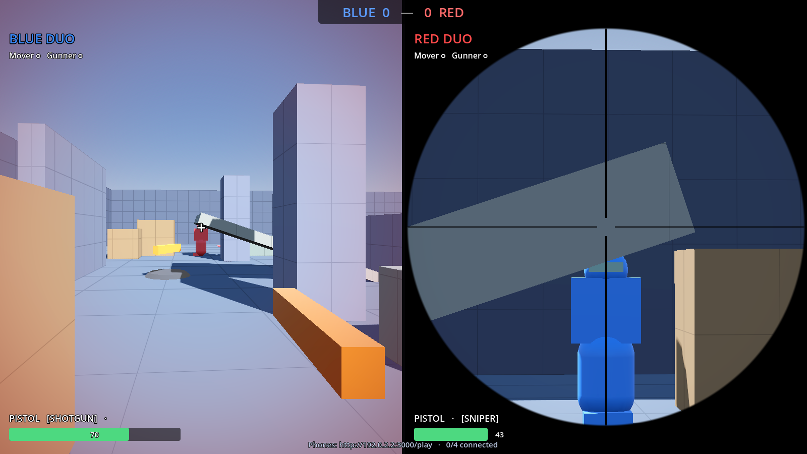

# Weapons & Combat

## Guns (confirmed on `main`)
| Gun | How you get it | Magazine / reload | Character |
|---|---|---|---|
| **Pistol** | Everyone starts with it | 12 / 1.25 s, never runs out | Reliable; bloom punishes spamming |
| **Shotgun** | Floating pickups on each team's **home porch** | 6 / 1.8 s | Fixed **ring** pellet pattern; short range |
| **Sniper** | Floating pickup **down in the pit** (the most exposed spot) | 5 / 2.2 s | Perfect when **scoped and still**; huge moving penalty |

- **Pickups:** walk through a floating gun to take it and switch to it. It disappears and **comes back after 10 s**. If you already own a full one, the pickup stays for the other team; if yours isn't full, it tops it up.
- **Gun models** are small scenes (`entities/weapons/models/*.tscn`) referenced from each gun's data. One model is used in first person, on the enemy-visible body and on the floating pickup.

*The floating sniper pickup with its glow pad (Arena v2 era).*

> [!NOTE]
> **Ammo history**
> I first decided **health only, no ammo or reload** (Sat 23:55) to keep the Duo simple. Aditya's `codex/fancy-ui` added magazines + reload; we merged it (Sun 01:41) and I adjusted it so **empty pickup guns vanish** and you go back for more. The README on `main` now says empty magazines **reload automatically** for all guns, so treat the README as the current rule.

## Scope
- **AIM** zooms the camera. On the sniper it shows a scope overlay **on that team's half only** and hides the first-person gun.
- **Scope glint:** the enemy sees a glint while you're scoped, a fair warning for "stand still and snipe".
- The scope overlay is its own node rather than more HUD code, so it merged cleanly with Aditya's HUD rewrite.

*Top: the scope view. Bottom: a split-screen moment with one team scoped on its target.*

## Hitboxes
Three plain **boxes** sized from one data file (`data/hitboxes/default_hitboxes.tres`), so retuning for a new model is just numbers.

| Zone | Hangs off | Damage |
|---|---|---|
| Head | `Torso/Head` (pitches with aim) | gun's `headshot_multiplier` (pistol/sniper 2.0, shotgun 1.5) |
| Body | `Torso` (turns with aim) | × 1.0 |
| Legs | `Legs` (turns with walking, squashes on crouch) | × 0.75 |

Example: the pistol does **44 / 22 / 16.5** to head / body / legs.

**F3 debug view** (keyboard practice): each screen draws the **enemy's** zone boxes (red, yellow, blue) and its own live spread circle.

## Spread: the teamwork lever
Spread is computed live: **base + bloom + moving add (scaled by speed) + airborne add, × crouch multiplier**.

| Gun | Base | Moving | Airborne | Crouch × | Bloom |
|---|---|---|---|---|---|
| Pistol | 0.6° | +1.5° | +4° | 0.7 | 0.35°/shot (max 2.5°, recovers 6°/s) |
| Shotgun | 6° | +1° | +2° | 0.85 | — (ring: 1 center + 8) |
| Sniper | 3° unscoped / **0° scoped** | **+6°** | **+10°** | 0.5 | — |

**Why the sniper penalty is huge:** a scoped sniper is perfect *only if the Runner stands still*. The Gunner has to yell "STOP!", so spread becomes a conversation, not just a balance number. This is the built half of the "stance" idea from the whiteboard ([03 Whiteboard Brainstorm](03-whiteboard-brainstorm.md) Board 7).

## Trails
Every shot draws a tracer streak plus an impact puff, with width, lifetime and size from the gun's data. The sniper's line is long and thick (0.05 m, 0.3 s), so **everyone sees where the sniper is**.

## Survival
| Mechanic | Status on `main` | Detail |
|---|---|---|
| **Spawn protection** | **Confirmed** | 2 s after a death (not at kick-off). Blocks **bullets only**, so falling and scripted damage still apply. Firing ends it early. The coat shimmers. |
| **Roofed spawn rooms** | **Confirmed** | Diagonal corners with two doorways; tested that no spawn point is visible from any camping spot ([10 Maps](10-maps.md)) |
| **Medkits / health pickups** | **Confirmed** (Brian, Sun 10:30–11:12: "health system working again", "more medkits added", "medkits fixed") | Health pickups call `HealthComponent.heal()`, capped at 100 |
| **Fedora = one-hit helmet** (its own HAT zone; hat hit = body damage, hat comes off) | **Not on `main`** | Built and tested by me, but the `Hurtbox.Zone` enum on `main` is still HEAD / BODY / LEGS. The hat **pop** is on `main`; the helmet rule isn't. |
| **Regen** (3 s without damage → 15 HP/s) | **Not on `main`** | Built and tested by me; the team went with medkits instead. Check with Brian before re-adding, so the two don't stack. |

## Old open question (resolved)
*Keep my `WeaponComponent` or Brian's `weapon_system.gd`?* `WeaponComponent` became the game's weapon system (the match mode, HUD and tests use it). Brian's armor and RPG ideas were not carried over.
