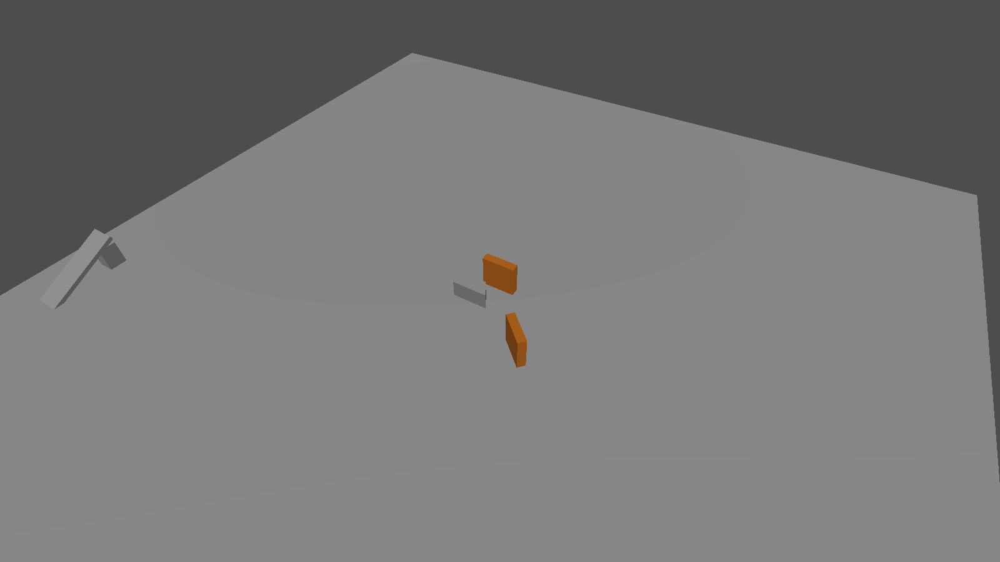
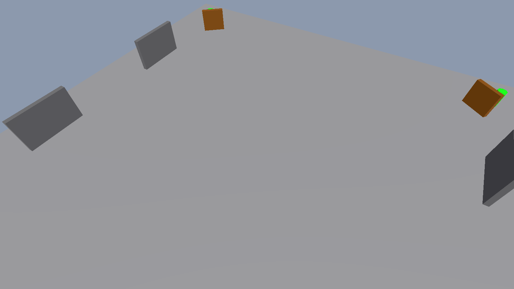
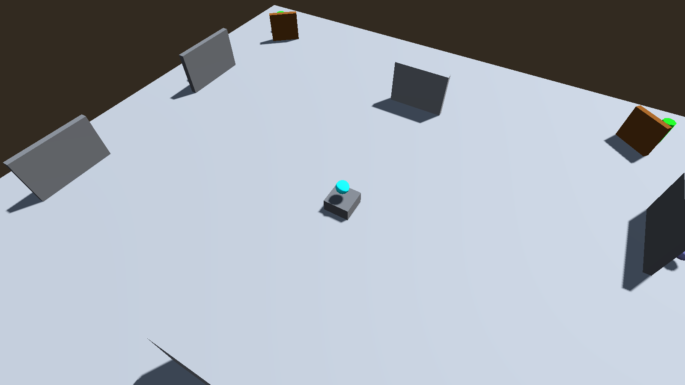
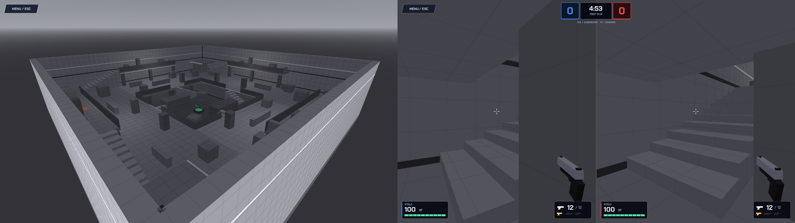
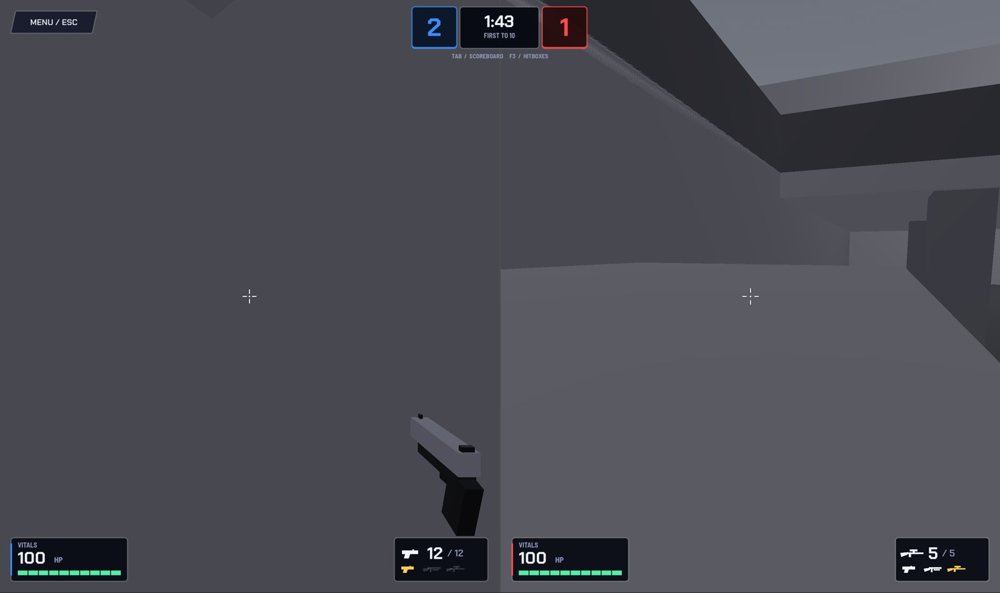
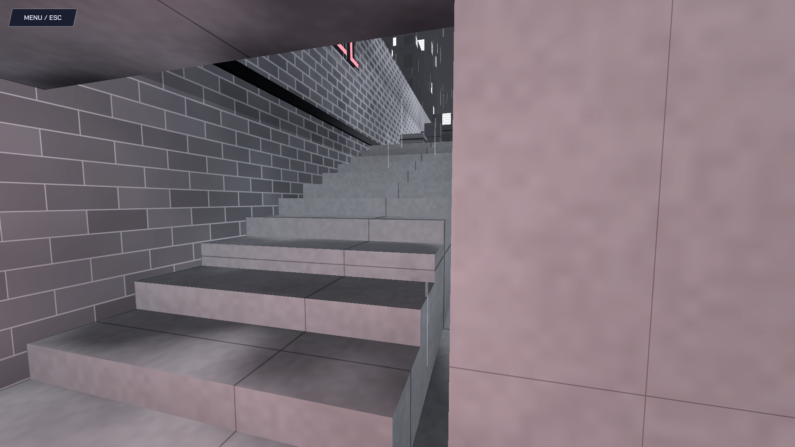
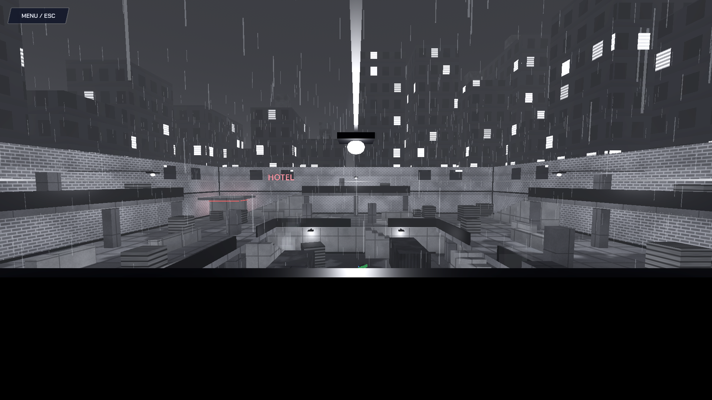
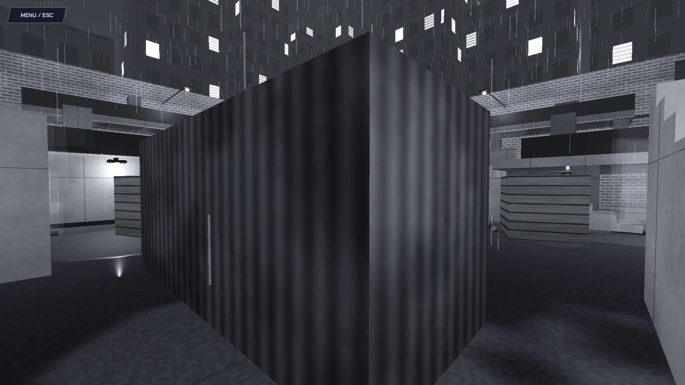

# Maps

The map went through five stages in about 18 hours, from Brian's first gray box to a rainy noir city block. The early images below were **re-rendered from the actual commits in git history** (Godot 4.7.1, editor-style overhead camera, players and cameras removed), so they show exactly what was on `main` at that time.

## Stage 1: First blockout (Brian, Sat 15:59–16:33)

*`node_3d.tscn` at commit `c9f3fe2` ("player model added"): a flat floor, a ramp ("created a ramp", 16:21) and a few test boxes. This was Brian's test level for his first player controller.*

## Stage 2: Arena box (Brian, Sat 18:19–19:45)

*`arena_box.tscn` at `659592f` ("started making the actual map"): a walled square with cover walls and corner spawn pads. Then came spawn points (18:45), more edits and lighting (19:29–19:34) and weapon spawns (19:45).*

*`arena_box.tscn` at `2492045` (Sat 22:04): health, armor and ammo pickups that disappear and come back. The cyan sphere is a pickup marker.*

**What I learned plugging my Duo into it:**
- The map's CSG pieces **had no collision**, so players fell through. My test scene turned collision on **at runtime** instead of editing Brian's file.
- An accidental editor save **rotated the map ~157°** in my test scene. Lesson: always read `.tscn` diffs ([15 Git Workflow & PR History](15-git-workflow-and-pr-history.md)).

*My split-screen test scene (Saturday evening): Team A left, Team B right, crude box Duos firing.*

## Stage 3: Arena v2 (me, Sun 03:31–04:00)

- A **new scene that instances Brian's map unchanged** and builds on top, so his edits still flow in. The match mode picks a map with one setting.
- **Three levels, Quake-style:** ground (0.5 m), decks (3.5 m), crow's nest (6 m) with the **sniper on top**.
- Center tower deck on pillars with open ground underneath; two side towers with half-rooms under them; bridges deck-to-deck.
- **Point-symmetric**: each team gets equal routes from its own side.
- Route tests: ramps, nest, bridge and under-deck all walkable.

## Stage 4: The Pit, gray (me, Sun 03:46–04:50)
Built from Quake / Unreal Tournament references (layered levels, structure above and below, no falling off the edge).

| Layer | Height | What's there |
|---|---|---|
| Pit | 0 m | **The sniper** (exposed from every level) |
| Ring | 3 m | Walkway around the pit; covered corridor underneath on the east/west sides |
| Porches | 6.5 m | Each team's **home porch** with a **shotgun** |
| Spawn rooms | corners | **Diagonal** (Blue NE, Red SW), roofed, two doorways |

- **8 staircases.** At first the stairs were "looks only" with a hidden ramp underneath, because Godot's CharacterBody can't climb steps and a ramp never snags.
- **Spawn rooms:** sightline-tested so **no spawn point is visible** from the pit, the ring, the porches or the other spawn.
- **Plain gray, one material per surface type**, so it could be themed later (an orange Quake-style sky was tried and was too much).

### My first playtest (Sun 04:06, my PC)

*Blue's half shows the layered Pit with the floating sniper below. Red's half shows the first problem: **spawning while staring at a flat gray wall**.*

*Two minutes later: still hard to tell where you are against untextured gray.*

**Fixes from that playtest:**
1. Each spawn point **faces its doorway**.
2. A **1 m grid shader** on surfaces, darker walls than floors, and dark edge lines (baseboards, corner posts).
3. **Staircases made solid.** You could walk *through* their sides because only the hidden ramp was solid. The ramp still does the climbing.

## Stage 5: The Pit, noir (me, PR #8, merged Sun 09:16)
Same layout; completely new look. Brief from Michael: *"noir, grayer tone, like city streets, where the red and blue characters stand out more."*

*Overhead: the Pit as a city block at night, with the skyline and lit windows all around.*

*Ring level: wet asphalt, rain, a red neon sign on Red's side.*

*Inside a spawn room: team-colored neon and a soft team-colored light (energy lowered to 0.7 after the first version glowed too red).*

*From a porch looking across the pit: streetlamps, rain and the far skyline.*

*Under the ring deck: the covered corridor in corrugated metal.*

| Element | How it's done |
|---|---|
| Surfaces | One `noir_surface.gdshader` with a `pattern` uniform: concrete, asphalt, brick, corrugated metal, crate wood, painted metal, windows (with blinds and an emission flag). World-space noise, **puddle gloss** on floors, grime toward the base of walls. |
| Lighting | Moonlight at 0.95, white streetlamps, ProceduralSky in grays, fog 0.01, glow |
| Team identity | **Red HOTEL** neon on the south wall (Red's side), **blue BAR & GRILL** on the north wall (Blue's side), team neon + an OmniLight in each spawn room |
| Atmosphere | Skyline of buildings, **2600 rain particles**, steam from drains |
| Collision | Scenery pieces are in the `visual_only` group, so `duo_sandbox._make_csg_solid` skips them and decoration never blocks movement |
| Build | Generated by a Python builder (`build_pit_noir.py`) → `apps/game/maps/the_pit.tscn` |

**Why noir works for this map:** a monotone city makes the **only saturated colors the teams** (red and blue neon, red and blue coats), which is what the whiteboard asked for: *"clean, distinct sides by color, monotone environment."*

Related: [11 Game UI & Noir Theme](11-game-ui-and-noir-theme.md) · [14 Art Direction](14-art-direction.md) · [18 Decision Log](18-decision-log.md) #42–#51, #61–#64
