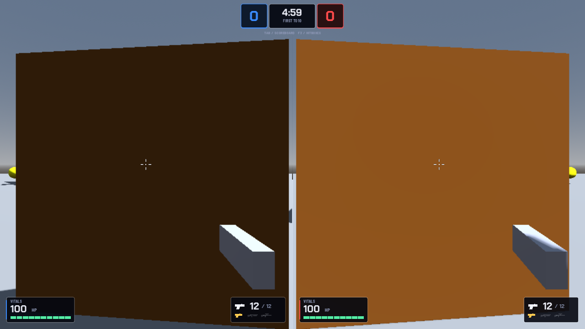
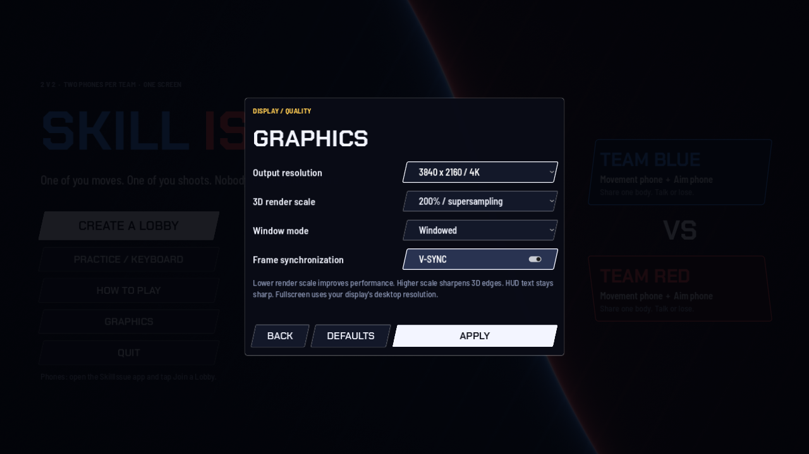
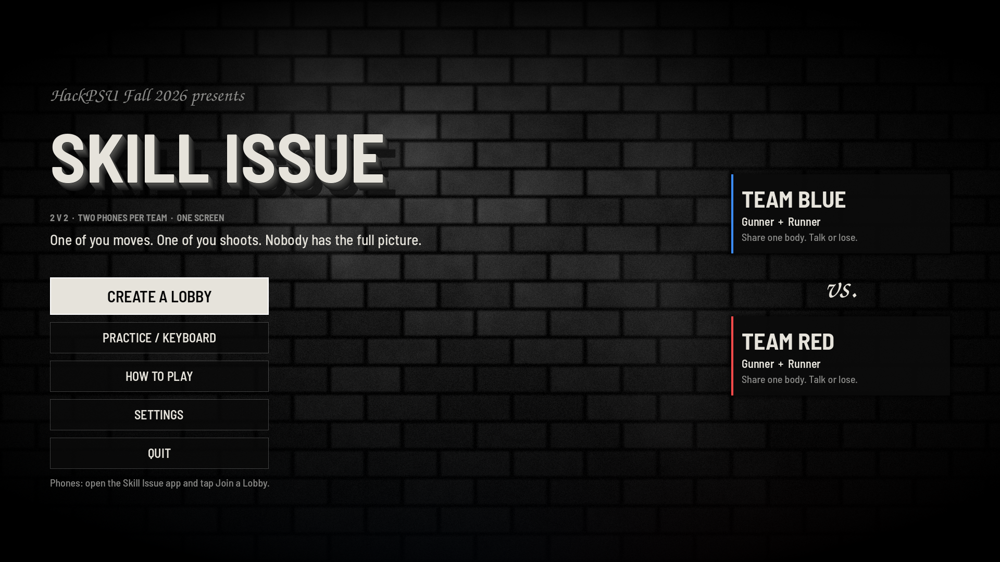
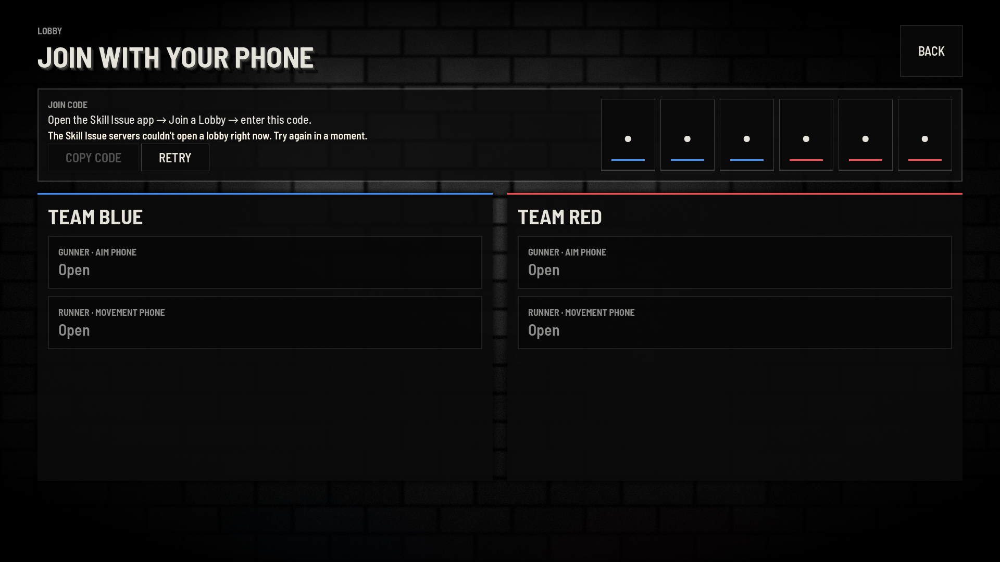
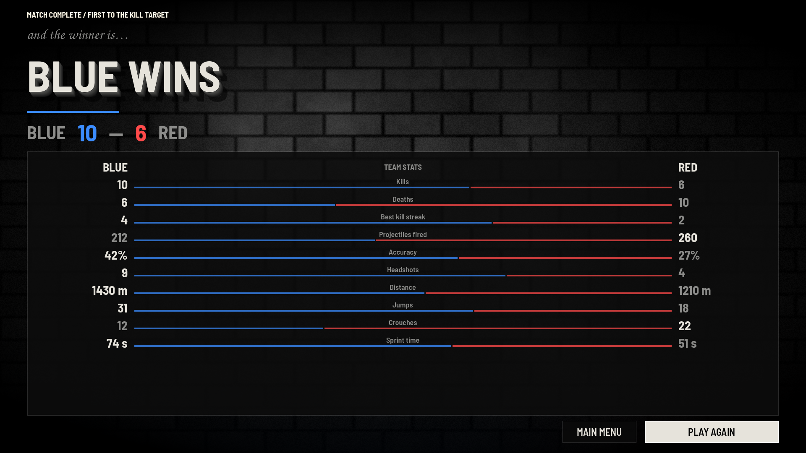
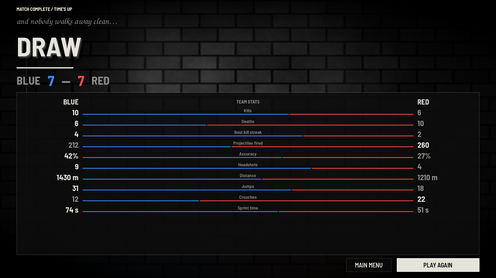
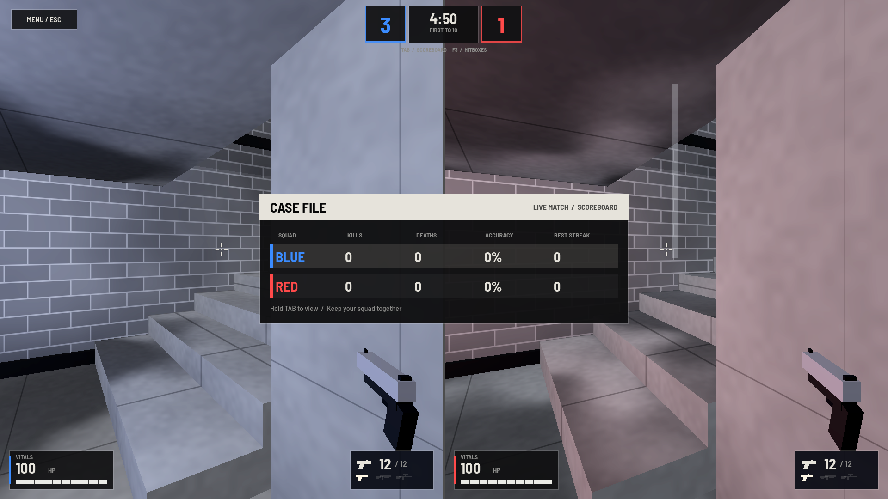

# Game UI & Noir Theme

## Before: Aditya's "fancy UI" (Sun 01:41–02:14)
Aditya's `codex/fancy-ui` branch gave the game its first real HUD, graphics and pause menus, and Skill Issue branding: navy panels, team-colored score boxes and a bright accent. Screenshots from the repo's `docs/previews`:

*Gameplay HUD: center score/timer, VITALS (HP) bottom-left, ammo bottom-right, per half.*

*Graphics menu: resolution presets (720p → 4K), render scale 50–200%, window mode, V-sync.*

## After: black-and-white film noir (me, PR #8, Sun 09:16)
**The brief, in Michael's words:**
1. Map first: *"noir, use like grayer tone, like city streets, where the red and blue characters stand out more."*
2. Then: *"make [the] other 3, menu, end, lobby more dark and gray, with only bits of red and blue accents."* (references: black-and-white film title cards)
3. *"Don't add that white light with silhouette in menu, just keep brick wall."*

### The UI kit (`apps/game/ui/ui_kit.gd`)
Everything is built in code by one UI kit, so one file restyles the whole game.

| Token | Value | Use |
|---|---|---|
| `BG` | (0.03, 0.03, 0.03) | near-black backgrounds |
| `INK` | (0.90, 0.89, 0.86) | off-white text |
| `MUTED` | gray | secondary text |
| `GOLD` → "hot white" | (1.0, 0.97, 0.90) | highlights (was gold; renamed in spirit) |
| `BLUE` / `RED` | unchanged team colors | **the only saturated colors on screen** |
| Display font | Barlow Semi Condensed Bold/SemiBold | titles, numbers |
| `SCRIPT` | TeX Gyre Chorus Medium Italic (GUST Font License, included) | film-title flourishes |
| Buttons | flat, square | |

**Helpers:** `title_3d(text, size, face, depth_ratio=0.12)` stacks labels to fake **extruded film-title lettering**; `wordmark`, `script_line`, `team_card_style(color, edge, fill)`.

**Background shader** (`canvas_item`): a **brick wall** with a soft spotlight, drifting smoke, film grain, light flicker, scratches and a vignette. The first version also had a lit doorway with a silhouette, which was **removed on request**.

### Screen by screen

**Main menu:** script line *"HackPSU Fall 2026 presents"*, the 3D **SKILL ISSUE** wordmark, team cards with a left accent bar, a script *"vs."*.

**Lobby:** 3D title, code tiles with a team-color underline, team panels with a top accent line, slot styles for open / taken / ready.

**Results:** script *"and the winner is…"*, a 3D banner with a team-color bar, gray table, muted bars. Ryan's later end-screen commit added the five final stats and the Gemini MVP card on top of this ([06 Match Flow & Rules](06-match-flow-and-rules.md)).

**Draw** variant.

**Tab scoreboard as a "CASE FILE":** an off-white header band, team-stripe rows, and a lamplight highlight on whoever is leading.

### In-match HUD
Score cells became **charcoal with a team underline**. Small color edits in `gameplay_vitals.gd`, `graphics_menu.gd` and `pause_menu.gd` brought Aditya's HUD into the same palette without restructuring it.

## Files touched by PR #8 (14)
`maps/noir_surface.gdshader` (+uid) · `maps/the_pit.tscn` · `ui/ui_kit.gd` · `ui/main_menu.gd` · `ui/lobby.gd` · `ui/results.gd` · `modes/duo_sandbox.gd` · `ui/gameplay_vitals.gd` · `ui/graphics_menu.gd` · `ui/pause_menu.gd` · `ui/fonts/TeXGyreChorus-MediumItalic.otf` (+ `.import`, license) · `project.godot` (the editor reordered its `[network]` section; harmless).

## Testing
Rendered every screen headless (xvfb) before handing it over; team smoke tests passed (gameplay 60 checks, lifecycle 25). See [17 Testing Log](17-testing-log.md) §14.
