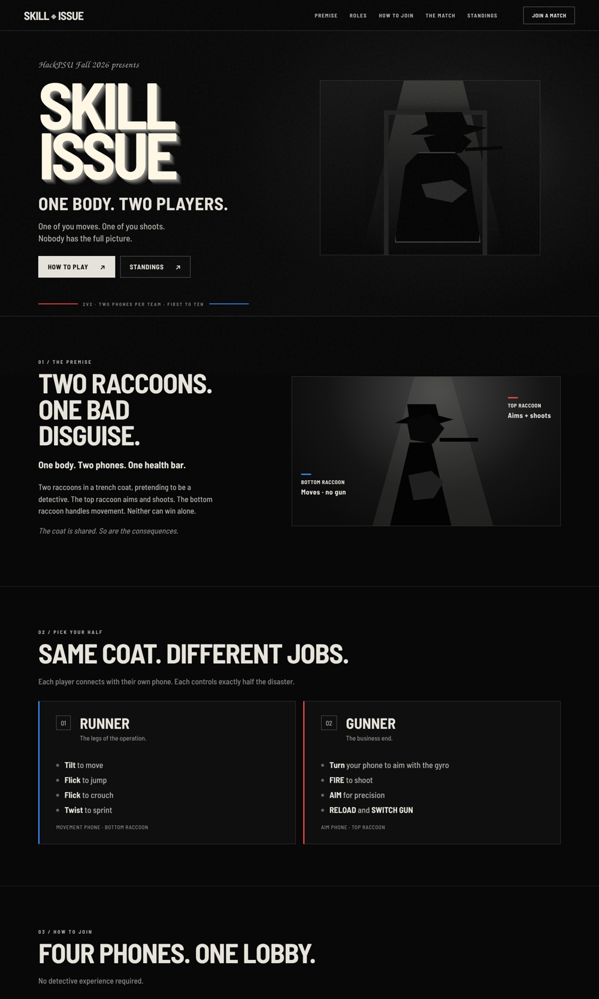

# Website: skillissue.vodka

## What it's for
The site is **outside the game**. Its job is to explain the gimmick, show off the look, and teach the roles and how to join. It is not meant to be a second copy of the in-game menus. It also hosts the **control plane** the game and phones depend on.

| | |
|---|---|
| URL | https://skillissue.vodka/ |
| App | `apps/landing`: Next.js 16 App Router, TypeScript, React 19, CSS Modules, pnpm |
| Hosting | Vercel project `skill-issue-landing` (Ryan's account). Every PR gets a **preview deployment** link from the Vercel bot. |
| API routes | `/api/games` (provision a lobby) · `/api/connection` (relay config for phones) · `/api/mvp` + `/api/mvp/badge` (Gemini) · `/api/leaderboard` (Tiger Data; returns 503 with `source: "unconfigured"` when not set up) |
| Local | `pnpm landing:dev`, `pnpm landing:build` from the repo root |

> [!IMPORTANT]
> **Don't break the API**
> The game and the phones call these routes. Any homepage change must leave `apps/landing/src/app/api/` untouched: check with `git diff -- apps/landing/src/app/api`.

## Design system
| Element | Value |
|---|---|
| Backgrounds | `#080808`, `#0C0C0C` |
| Main text | `#E6E3DB` |
| Secondary grays | `#8C8B88`, `#B5B3AE` |
| Warm highlight | `#FFF8E6` |
| Team accents | Red `#FF4A4A`, Blue `#3B8CFF` |
| Type | Barlow Semi Condensed (Bold, SemiBold, Medium), local files |
| Script flourish | TeX Gyre Chorus Medium Italic (keep the license) |
| Big title | Off-white block letters with a down-right gray extrusion |
| Buttons | Flat, square; white fill or thin gray outline |
| Panels | Dark, faint 1 px outlines, tiny team-colored edge rules |
| Effects | Grain, vignette, faint flicker, **off under `prefers-reduced-motion`** |

This matches the in-game UI kit on purpose ([11 Game UI & Noir Theme](11-game-ui-and-noir-theme.md)).

## How the homepage got where it is
| When | What | By |
|---|---|---|
| Sun 04:02 | Landing app + control plane created | Ryan |
| Sun 04:51–05:48 | README/footer for HackPSU; character hero images; arena styles | Ryan |
| Sun (morning) | Several redesign rounds in other chats: noir website prompt → Next.js redesign zip (I fixed missing team credits, visible placeholder labels, no script font, and a leaderboard that errored on 503) | me |
| Sun (morning) | Michael preferred a **PNG-based design**: the approved hero art shown as an image with **transparent clickable hotspots** over the nav and buttons, plus HTML panels below (How to Join, The Match, Standings) | me (design chosen in another chat) |
| **Sun 11:05, PR #10** | **Homepage swap**: `/` now serves `public/home-preview.html` via a rewrite; `page.tsx` untouched | me |
| **Sun 11:18, PR #11** | **Standings removed**: painted the STANDINGS nav item and button out of the hero PNG using matching texture, removed the two `#standings` hotspots, the nav link and the section; added a footer style | me |
| Sun 11:25 | **The Arsenal** (weapons section) added before The Pit; leaderboard dropped; page menu reads Weapons / The Pit | Ryan |
| Sun 11:45 | Lobby-code boxes **scramble and settle** on a random code | Ryan |

### The swap (PR #10)
```ts
// apps/landing/next.config.ts
async rewrites() {
  return { beforeFiles: [{ source: "/", destination: "/home-preview.html" }] };
},
```
**Swap-back plan** (the old homepage was tagged `site-before-preview` first):
```powershell
git checkout site-before-preview -- apps/landing/next.config.ts
git rm apps/landing/public/home-preview.html
```
Or simply delete the `rewrites()` block; `page.tsx` is untouched.

### Why an image-based page (trade-offs)
- **For:** exact fidelity to the approved art; fast; no redrawing stylized raccoons in CSS.
- **Against:** text baked into the image can't be selected, resized or read by screen readers; hotspots must line up as the image scales; small phones make the text hard to read; heavy images.
- **Fix-later list:** accessible names + visible focus on hotspots; HTML equivalents for text baked into the PNG; check at 375 px with no horizontal scroll; optimize the images.

## The unused alternative
A full Next.js noir redesign (Chorus script, extruded title, Runner/Gunner cards, 503-safe leaderboard) was built and previewed but **not shipped**, because Michael preferred the PNG art. It's kept as an option:



## QA checklist (still open)
- [ ] 375 px / tablet / laptop / wide desktop
- [ ] Hotspots aligned at every width, with keyboard focus
- [ ] Every nav item and CTA reaches a real section (after the standings removal, nothing points to `#standings`; verified for PR #11)
- [ ] Reduced motion: no flicker
- [ ] Image weight
- [ ] `/api/*` unchanged

Delete the `site-before-preview` tag once the new homepage is final.
