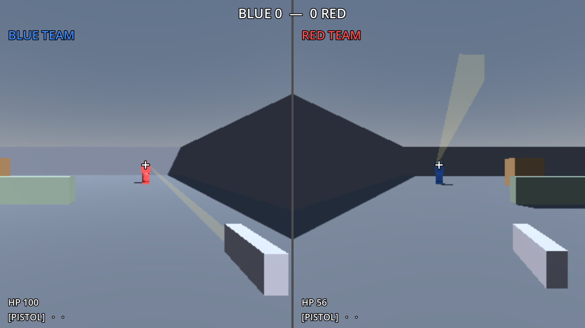
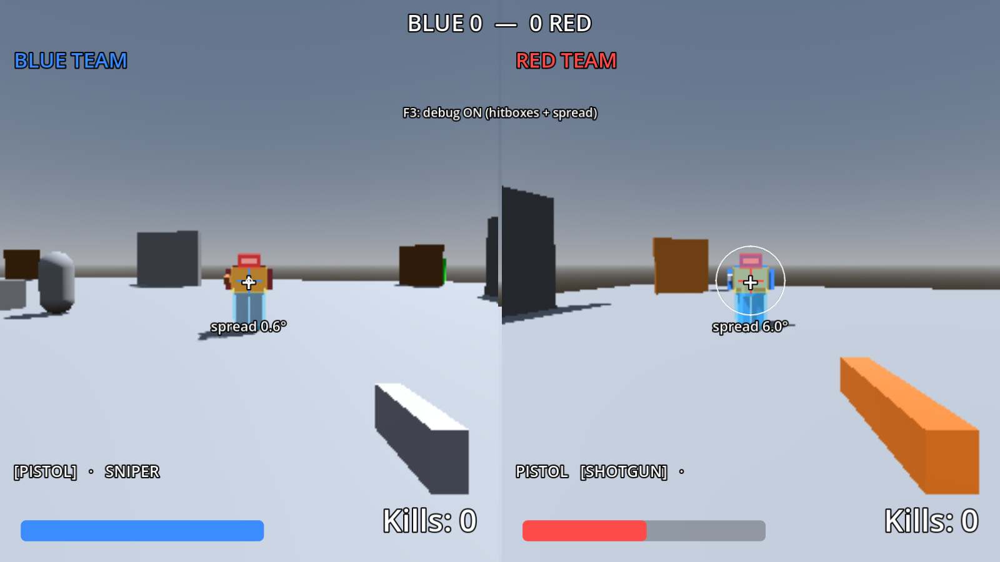
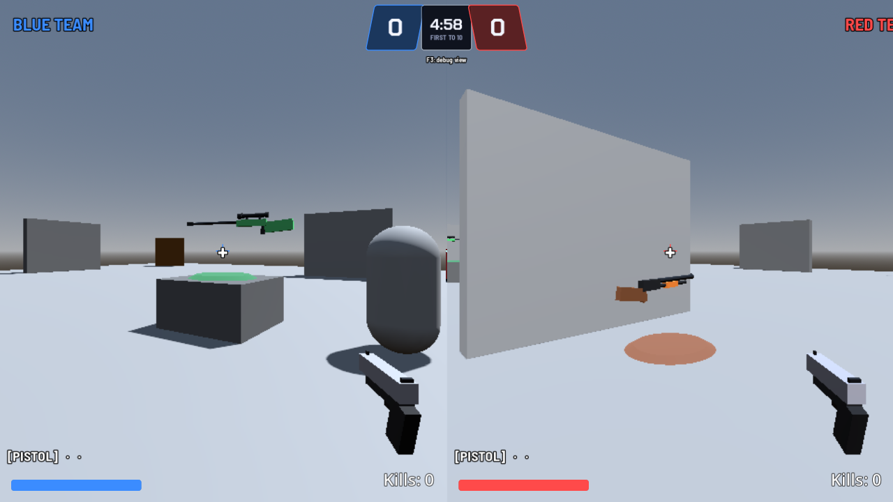
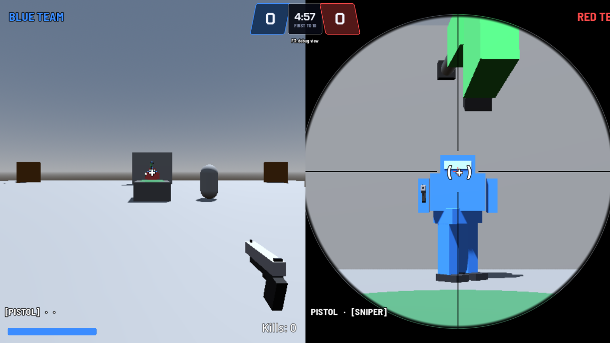
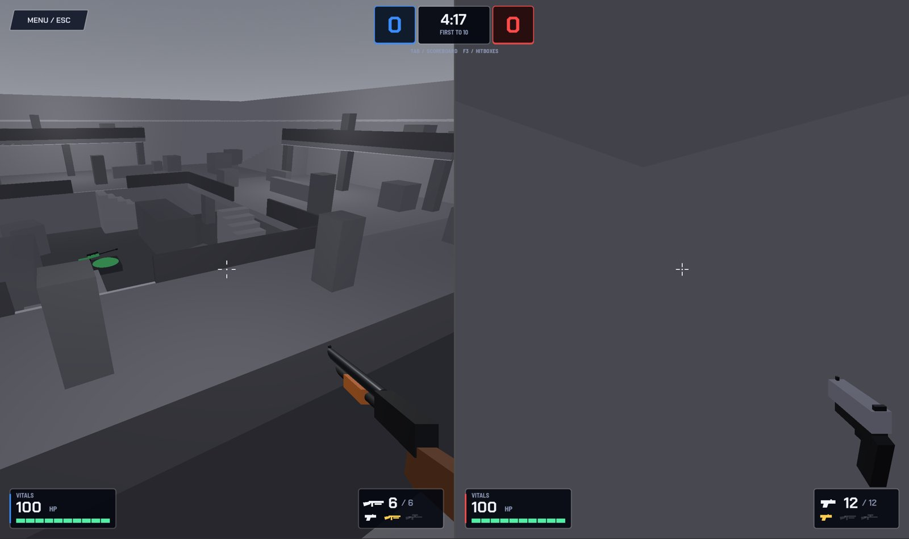
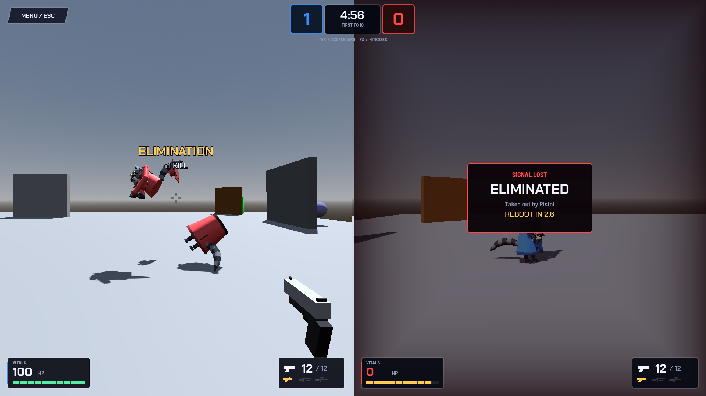

# Testing Log

All tests were automated in headless Godot (4.7.1, the team's version) on **copies** of the code, never on my computer or the live repo, unless a section says "on my PC". Renders use xvfb.

**Suites:**
- **Team smoke tests:** `tests/gameplay_smoke.gd` (now 60 checks) and `tests/lifecycle_smoke.gd` (25 checks, real WebSocket phones).
- **Mine (kept outside the repo):** check, map_check, pit_check, spawn_check, weapon_check.

## 1. Standalone prototype (Godot 4.5.1), 4 simulated phones through the relay
19/19 passed: tilt moves the duo, gyro turns the camera, legs face the walk direction, pistol hitscan, shotgun pickup + auto-switch, phone gun buttons, pistol can't scope / sniper can, kill gives a point, respawn with full HP and pistol only, crouch shrinks the hitbox, each duo's hitbox is independent.

**Bug found by testing:** the first pistol test "missed". The cause was the test itself (fake phones were still moving and turning the shooter), not the game. The fix was to freeze input during the shot.

## 2. Rendering check (screenshots)
- Split screen, viewmodels, floating pickups, sniper scope shader, and hit flash all render.
- Fixed: the score bar overlapped the red team label; the first-person gun was too close to the camera and looked like a plank.

## 3. Phone controller page (mobile browser screenshots)
- Fixed: the **Android Chrome permission bug** (see [07 Controls & Motion](07-controls-and-motion.md)), a FIRE button rendering as an ellipse, and the CROUCH label layout.

## 4. Team repo (Godot 4.7.1, Jolt physics, GL Compatibility), same as the team's setup
Split-screen test scene: **16/16 passed**
- Team A camera on the LEFT view, Team B on the RIGHT, both in first person
- Each team can't see its own body but sees the enemy's
- Walking, aiming, cross-map pistol kill, scoring, respawn, falling off the map kills
- **The team's `main.tscn` was verified byte-for-byte unchanged**

## 5. Player model (Godot 4.7.1)
**15/15 passed:** third-person gun on the enemy-visible layer and matching the weapon, team tint vs dark parts, legs swing / settle / squash / stand, sniper model swap, hit flash on and fading, cockpit = 2× headshot, chest = normal damage. The earlier 16 still pass.

## 6. Final package
Installed on a fresh copy of the repo exactly as I'll do it on my PC: all tests pass, and teammates' files are unchanged.

## 7. Against teammates' newest commits (map + globals)
- Re-tested on `origin/main` after teammates added global scripts, a HUD, and the real map: **all checks pass**, plus 3 new checks that the Duo feeds their `GameEvents` (kill, score, health).
- Their map's CSG pieces had **no collision**, so players would fall through. The sandbox turns it on at runtime only and spawns on their corner pads (+Z pads = Team A, −Z = Team B).
- Two test "failures" were my test's timing, not bugs: checking before the duo landed, and walking straight into the cover wall that protects each spawn (their map design working).

## 8. On my own PC
- Godot 4.7.1 (Compatibility renderer, Intel Iris Plus): `duo_sandbox.tscn` runs with no errors, and the split screen works on the real map.
- `git status` after opening Godot showed only my 5 folders, so the editor didn't modify teammates' files.

## 9. Hitboxes, spread and trails (Godot 4.7.1, team's latest `main`)
**24 new checks pass**, plus the earlier suites (59 total):
- Zones are sized from the profile; each duo has its own shapes; legs are ×0.75
- Pistol does exactly 44 / 22 / 16.5 to head / body / legs
- Tracer width and lifetime plus impact size come from the gun's data
- Spread: 0.6° still → 2.1° walking → 0.42° crouched → 4.6° in the air; bloom grows 0.35°/shot and recovers
- Shotgun ring: 9 pellets, identical every shot; sniper scoped is 0° still, 6° moving
- F3 debug view: enemy zones on the right render layer, spread circle on both halves

**Bugs found while testing:**
1. **The merged test scene had the map rotated ~157°.** Godot saved a rotation into `modes/duo_sandbox.tscn` while it was open in the editor, before the PR #1 commit (most likely an accidental drag with the rotate tool). Duos spawned off the map edge. It only affected my test scene, not Brian's map. **Fixed** by removing the override. Lesson in [15 Git Workflow & PR History](15-git-workflow-and-pr-history.md).
2. **The F3 view tinted the whole screen**, because each duo's own hitbox boxes surrounded its own camera. Fixed: each screen shows only the enemy's boxes.
3. **Kenneth's new HUD overlapped my test-scene labels.** Moved mine and dropped my duplicate HP readout. His health bar and kill counter now show real data from the Duo.

## 10. Hitboxes v2 on the new `main` (00:00)
All three suites pass on `main` @ `345c972` (Brian's new map, Kenneth's networking, sprint). Sprint edits kept; none of the teammates' files change.
- **00:45 on my PC:** installed on branch `hitboxes-spread` (`git status` = 12 modified + 3 new, all in my folders). Ran `duo_sandbox.tscn` with F6 → F3: enemy zone boxes, spread circle, tracers and impacts all work.

## 11. Weapon pickups, gun models, scope (02:30, `main` @ `da3c13a`)
**33 new checks pass** (plus the earlier suites):
- The map's 3 gun spots become pickups (1 sniper, 2 shotguns), the placeholder spheres are hidden, and the glow pad lands on the surface below
- Walking into a pickup gives + switches to that gun; it vanishes and comes back after 10 s; the other team can take it too
- First-person and enemy-visible guns use the right model on the right render layer, keep their own colors, and the muzzle moves to each barrel tip
- Cycling skips guns you don't own and wraps around; respawn resets to the pistol
- Scoping: overlay on that team's half only, camera zooms, first-person gun hides, the enemy sees a glint
- Also simulated merging with Aditya's `codex/fancy-ui` (ammo/reload + new HUD): no conflicts, tests still pass

**Bug found:** both Duos got the sniper at the start of the match. They exist at the world origin for one frame before moving to their spawns, and the sniper floats over the origin. **Fix:** pickups only become active after a few physics frames.

## 12. My first playtest of The Pit (04:06, my PC)

- **Spawned staring at a flat gray wall:** hard to tell where you are. Fixed: each spawn point faces its doorway, and surfaces got a 1 m grid with darker walls and dark edge lines.
- **Could walk through walls:** the staircases were visual-only (only the hidden ramp was solid), so you could walk through their sides. Fixed: steps are solid now; the ramp still does the climbing. Route tests updated (the old path went straight through a staircase).

## 13. The Pit: spawn protection, hat pop, death split, polish (04:26–04:50)
- Spawn protection: bullets do nothing for 2 s after a respawn, but falling still kills; firing ends it early; no protection at kick-off.
- Hat pop fires on a killing headshot too (the signal comes before the damage).
- Death split: two physics raccoons on the world layer, visible on both screens, short-lived.
- All suites plus the team smoke tests pass on the newest `main`.

## 14. Noir theme (PR #8, Sun ~08:00–09:15)
- Map: **map_check / pit_check / spawn_check** still pass on the noir build. The builder tags scenery `visual_only` so `_make_csg_solid` skips it, which means decoration never blocks movement.
- Renders (xvfb) of the overhead view, ring, spawn and play, plus menu / lobby / results / draw / case-file board.
- **Found by looking, not tests:**
  1. The first noir pass was too dark and amber → neutral gray + white + red/blue neon.
  2. The red spawn-room glow was too strong → OmniLight energy 0.7.
  3. The menu doorway + silhouette weren't wanted → removed.
  4. Godot 4 already has a built-in `script` property, so my helper named `script` clashed → renamed it to `script_line`.
- Team smoke tests: **gameplay 60/60, lifecycle 25/25**.

## 15. Phone app noir (PR #9, Sun ~09:30–10:00)
- TypeScript syntax check of every changed file (local TypeScript compiler).
- Screens rendered in a browser mock with Playwright for review.
- **Limit:** the npm registry wasn't reachable from my workspace, so the full Expo typecheck/lint wasn't run there. Ryan's environment builds it.

## 16. Website homepage swap (PR #10, Sun ~10:40–11:05)
- Rendered previews with esbuild + react-dom/server and Playwright screenshots, desktop and mobile.
- Verified the swap is **one rewrite in `next.config.ts` plus one HTML file**, with `/api/*` untouched.
- Checked on the **Vercel preview deployment** from the PR before merging.
- The merge error ("We couldn't merge this pull request") came from `main` moving. Updating and retrying fixed it.
- On my PC: `Expand-Archive` failed because the zip wasn't in `Desktop\2v2`. I used the HTML in Downloads plus a PowerShell here-string for `next.config.ts`.

## 17. Standings removal (PR #11, Sun ~11:10–11:18)
- Painted out the STANDINGS nav item (912–998, 22–50) and button (286–486, 530–596) in the 1536×1024 hero PNG with matching texture.
- **Bug:** the first patch picked up a faint horizontal rule line from the donor area → switched to a clean donor patch.
- Checked that no `#standings` link or hotspot remains and the rest of the page is unchanged; desktop + mobile screenshots.

## 18. What actually made it to `main` (audit, Sun 11:47)
| Feature I built | On `main`? |
|---|---|
| Hitboxes, spread, trails, F3 | ✅ |
| Weapon pickups, gun models, scope + glint | ✅ |
| The Pit + spawn rooms + spawn protection | ✅ |
| Hat pop, death split | ✅ |
| **HAT helmet zone** (fedora absorbs one headshot) | ❌ `Hurtbox.Zone` is HEAD/BODY/LEGS |
| **Health regen** (3 s delay, 15 HP/s) | ❌ medkits instead (Brian) |
| Noir map, UI, phone app | ✅ |
| Homepage swap, standings removal | ✅ |

## Still untested / unknown
- **Real phones at the venue:** sensor directions, lag, Wi-Fi. Results are **not recorded** in these notes.
- **4 real people** playing a full match: **not recorded**.
- iPhone install path (Expo Go is SDK 54 vs the app's SDK 58; see [12 Phone App](12-phone-app.md)).
- Website accessibility (hotspot focus, 375 px).
