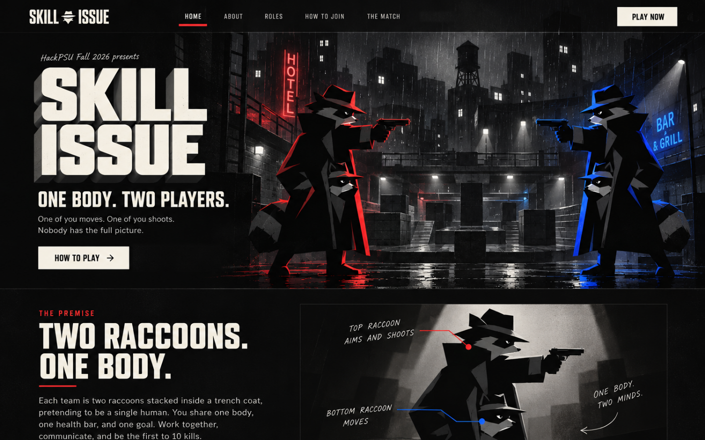
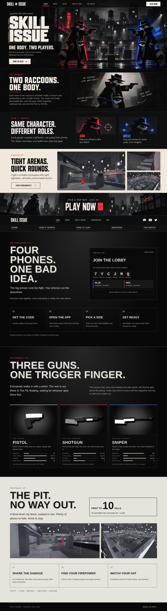
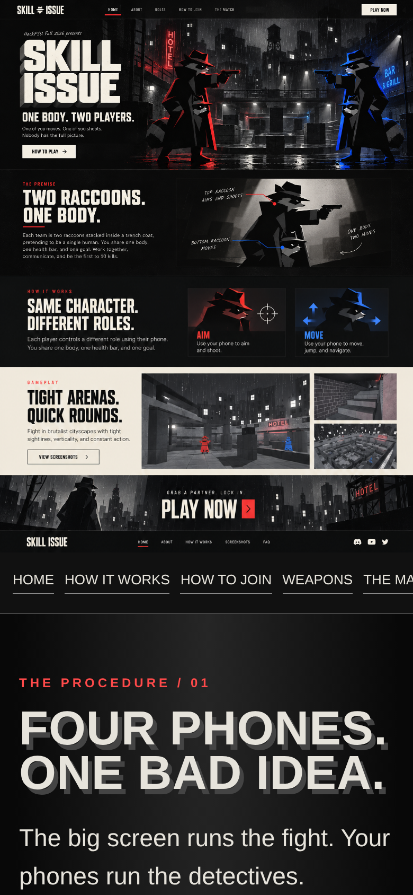

# Website snapshot: skillissue.vodka

The game's website ran at **[skillissue.vodka](https://skillissue.vodka/)**. The domain was registered for a short time, so this folder keeps a permanent copy that still works after the domain expires.

| What | Where | Opens on GitHub? |
| --- | --- | --- |
| Full-page screenshots, desktop and phone | [`screenshots/`](screenshots/) | Yes |
| The working page itself (one self-contained HTML file, all images built in) | [`apps/landing/public/home-preview.html`](../../apps/landing/public/home-preview.html) | Download and open it in any browser; it works offline |

The screenshots were rendered from `home-preview.html` on `main`, the exact file the live site served at `/`, in headless Chromium at 1440 px (desktop) and 390 px (phone).

## Desktop

  

<b>Full page on desktop</b> (click to expand)

 

## Phone

<table>
  <tr>
    <td width="40%"></td>
    <td><b>On a phone</b>, the poster scales down and the sections stack into one column.  <a href="screenshots/homepage-mobile-full.jpg">Full page on a phone</a></td>
  </tr>
</table>

## What was on the page

| Section | Content |
| --- | --- |
| **Hero** | The poster artwork with clickable buttons laid over it: *One body. Two players.* |
| **Roles** | Two raccoons, one body; how the Runner and Gunner split the controls |
| **How to join** (`#join`) | Four phones, one lobby code: get the code, open the app, pick a side, get ready |
| **The Arsenal** (`#arsenal`) | Pistol, shotgun and sniper, with damage, fire rate, range and magazine |
| **The Match** (`#match`) | The Pit, first to 10 kills, and the core rules |

## How the homepage worked

The site is the Next.js app in [`apps/landing`](../../apps/landing/README.md), hosted on Vercel. The homepage is a single poster-style page (`public/home-preview.html`), served at `/` by one rewrite in `next.config.ts`; the original `page.tsx` is untouched. The same app also serves the API the game and phones rely on (`/api/games`, `/api/connection`, `/api/mvp`), which is why the site mattered beyond marketing.

Design history, including an unused Next.js redesign, is in the journal note [13 Website](../hackathon-journal/notes/13-website.md).

## Viewing the live page from GitHub

GitHub shows HTML files as source code, not as a page. Three ways to see it rendered:

1. **Download** `home-preview.html` (open it on GitHub, then select **Download raw file**) and double-click it.
2. **GitHub Pages:** turning on Pages for this repository would give the page a permanent free URL.
3. Clone the repo and open `apps/landing/public/home-preview.html` in a browser.
